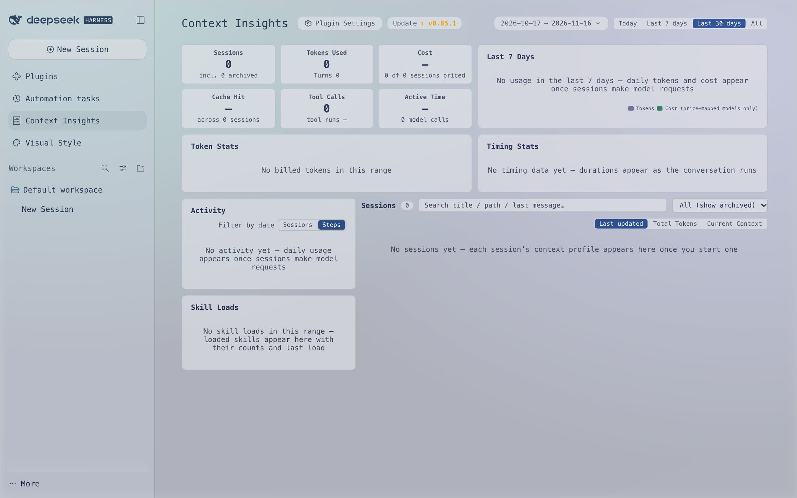

# DSH Livery (dsh-livery)

[](LICENSE)
[](https://www.npmjs.com/package/dsh-livery)
[](package.json)
[](#supported-dsh-builds)

> **Make your DSH beautiful to look at — and alive to use.**

A visual layer for DeepSeek Harness: **28 curated styles**, a wallpaper studio with
access-gated online images and blur/frost effects, and a style gallery. It is a
plugin, not a host theme takeover.

> **Release status: `0.2.3` is the current release (2026-11-26).**
> The artifact is `dsh-livery@0.2.3`; all 13 declared scopes and the
> `0.2.2 → 0.2.3` Web in-process update transition have acceptance evidence.
> **Stable certified:** DSH `0.2.1-rc.2` + Web Profile, and DSH `0.2.1-rc.3` +
> macOS Desktop. **Preview:** DSH `0.2.1-rc.4` Web, DSH `0.2.1-rc.5` Web/Desktop,
> DSH `0.2.2-rc.1` Web/Desktop, DSH `0.2.2-rc.2` Web/Desktop, DSH `0.2.2-rc.3`
> Web/Desktop and DSH `0.2.2-rc.5` Web/Desktop. The `0.2.3` claim is **exact-certified only**:
> unknown builds fail closed; Windows Desktop, Edge and other DSH builds remain
> unsupported.

English · [中文](README.zh.md)


Screenshots are from the English UI; the Chinese README uses the Chinese UI.
Livery follows the DSH host locale. The Visual Style page shown here is unchanged
in `0.2.3`; the wallpaper studio, direct-display sources and plugin-detail surface
are documented in the design notes and CHANGELOG.

## What's new in 0.2.3

`0.2.3` is a client/Host feature release on the same eight exact-certified host
adapters as `0.2.2`; it adds no host adapter and no new host capability.

- **Two keyless direct-display sources.** Cleveland Museum of Art and The Met are
  offered alongside Wikimedia Commons. Their image CDNs are displayed through a
  plugin-owned `` layer; no CORS, blob cache or
  body-background URL is assumed.
- **Host-served provider manifests.** `/livery/api/providers` is the reviewed
  registry; the client contains no per-provider fetch implementation.
- **Search-only direct sources.** Selecting Cleveland or Met auto-loads its
  default batch; Random is omitted, unavailable actions are omitted rather than
  rendered disabled, and result count + attribution share one status line.
- **Contrast and UI hardening.** Host component token pairs are audited against
  the stock host, the selected sidebar state keeps a visible accent and rail step,
  and the Online card is reduced to one control row plus one contextual status.
- **A real `0.2.2 → 0.2.3` Web update transition.** The release keeps the
  existing client gzip cap and the stale-boot repair path.

## What's new in 0.2.2 (previous)

`0.2.2` is a client-only feature release on the same eight exact-certified host
adapters as `0.2.1`; it adds no host adapter and no new host capability.

- **A curated wallpaper studio with a Classic escape hatch.** Exactly 8 curated
  built-ins (`paper`, `ink`, `aurora`, `cyber`, `dusk`, `minimal`, `mono`, `sand`)
  fill the main grid; the other 16 stay loadable as **Classic** with
  byte-identical IDs and CSS in a collapsed group. A legacy selection gets a
  pinned “Current (Classic)” swatch, so no ID is lost or remapped.
- **Follow style.** A generated `kind: 'style'` background follows the active
  Livery and is derived from catalog tokens per light/dark mode. It is not
  repositionable and is disabled with a visible reason when catalog tokens are
  unavailable. Preset schema v2 carries the style target and attribution URLs;
  v1 presets remain importable.
- **One access-gated online source.** **Wikimedia Commons** is the only offered
  online source in 0.2.2: keyless, CORS-verified and returning real
  licence/attribution metadata. Openverse was accepted by the access gate but
  removed from the offered registry because its anonymous limits made it
  unusable; stored legacy selections still render from cache without new
  requests. NASA, The Met and the Art Institute of Chicago are not listed
  (rights or image-CDN verification blocked); Picsum is removed because the
  Unsplash licence does not permit this use. Existing Picsum remote selections
  still render from cache; no new result carries a Picsum licence.
- **Predictable requests.** Opening the wallpapers page defaults to the Online tab
  and automatically requests exactly one Random batch; a persisted online
  wallpaper may still load through the guarded local cache. Later tab switches do
  not refetch, and there is no polling or prefetch. Auto tries the offered
  gate-passed providers under a 12 s deadline and names the provider that served
  the results; a pinned provider never switches silently. Empty and
  failure states are explicit, with Retry and links back to Built-in/None.
- **Safe attribution.** Creator, licence and source links are stored with the
  selected remote image, validated as HTTPS, and opened with
  `rel="noreferrer noopener"`. Recent history is a display mirror, not a second
  source of truth.
- **A plugin detail page.** Livery consumes the `plugins.detail.actions`,
  `plugins.detail.badge` and `plugins.detail.section` slots to show observable
  facts (build, boot handshake state, host/adapter, active style and wallpaper)
  and a truthful update boundary. The slot proof covers 6 of 8 hosts; on
  `0.2.1-rc.3` Desktop the static proof is a recorded gap and the runtime detail
  check is not implemented yet, so that surface is a documented limitation. It adds no update button and does not duplicate
  the Host's install control.
- **Web hot-update boundary.** A real `0.2.1 → 0.2.2` Web client update can be
  repaired in process: an exact allowlisted stale boot payload is accepted, the
  catalog is re-fetched and the saved config re-applied, with strict
  catalog-profile equality and no CSS adoption from the stale frame. Desktop
  requires a renderer reload/app restart; no Desktop hot update is claimed.

## Highlights

- **28 styles across six visual axes.** Colour (OKLab seeds → complete light/dark
  tokens), typography (13 local-only font stacks, including 6 CJK families, and 9 typography profiles), shape,
  elevation/material, border/focus treatment and component chrome. The set includes
  14 original designs, 12 permissively licensed palettes and 2 original Chinese
  designs.
- **A live preview, not a hero-plus-scroll.** The current style shows a real DSH
  surface beside its description; 28 styles sit in one continuous 6/4/3/2-column
  grid, with the family chips as the only taxonomy.
- **Style DNA on every card.** Each card names its surface recipe, component
  chrome and UI type family, so visually different designs are recognisable before
  applying them.
- **GUI-first palettes.** Blueprint, Bauhaus, Clay and Phosphor push the set beyond
  colour swaps: engineering cyan, mustard/cobalt display type, terracotta pills and
  green CRT terminal surfaces.
- **Component chrome.** `layout.chrome` can tint, outline, darken or block-fill the
  rail, composer, bubble, active row and selector from the palette seeds; six
  recipes ship and all 28 styles choose one.
- **Wallpaper studio.** Access-gated Wikimedia Commons plus the 0.2.3 direct-display
  Cleveland Museum of Art and The Met sources (Openverse was removed in 0.2.2
  because anonymous limits made it unusable) with per-image attribution, 24 CSS
  wallpapers total (8 curated + 16 Classic),
  Recent, a generated Follow-style background, and local/link uploads
  (IndexedDB). Blur 0–24 px, dim 0–70 %, frost 0–100 % and a global atmosphere
  overlay. The painted wallpaper layers are viewport-relative `cover`, so images
  crop without geometric distortion. Opening the page defaults to Online and
  automatically requests one Random batch (a saved online image may also load
  from cache); later source-tab switches do not refetch.
- **Presets and focal position.** Export/import style + wallpaper + effects +
  nine-grid focal point; remote/upload wallpapers support pointer and keyboard
  focal positioning. Schema v2 adds the Follow-style target and attribution URLs
  while v1 presets remain importable. Presets never contain uploaded blobs, CSS,
  tokens or paths.
- **Legible, distinct macOS rail.** The sidebar fill is frosted slightly more than
  the main column (`+20 %`, capped at 94 %) so labels stay readable over a light
  wallpaper while the rail keeps a visible wallpaper trace. The host still owns
  its final tint/wash composition; the probe measures the real DOM surface.
- **Plugin detail page.** The plugin manager's Livery detail page shows observable
  facts (client build, boot handshake state, host/adapter, active style and
  wallpaper) and a truthful update boundary. Web client updates can be repaired in
  process; Desktop needs a renderer reload/app restart. No update button or fake
  control is added.
- **Trust by construction.** Exact host allowlist, frozen contracts, token-only
  CSS, loader-ABI checks, contrast/CSS audits and committed acceptance evidence.
  Unknown hosts are rejected at install and fail closed to stock at runtime.

## Styles


Six of the 28 styles: **Blueprint, Bauhaus, Clay, Phosphor, Cinnabar and Graphite**.
Each tile is a live DSH surface with that style applied; the gallery uses the same
preview scenes.

## Wallpapers

The wallpaper studio and its live 16:9 preview. Opening the wallpapers page
defaults to Online and automatically requests one Random batch; Built-in remains
one click away. Selecting Cleveland or The Met loads their default batch
immediately (both are search-only; Random is disabled). Auto names the provider
that served the results. Blur, dim, frost and the global
atmosphere controls apply to the whole interface. Focal positioning is available
for remote and uploaded wallpapers, not for built-in or Follow-style
backgrounds. Wallpaper choices stay local.

## Every DSH plugin page



The Context insight page shown with the same active style and wallpaper. Host
plugin pages such as Trajectory, Context and Agent Team share the livery token
layer: cards, tables and overlays get the same surface ladder, and third-party
chart palette variables resolve to the active livery tokens. No per-plugin
selectors or hashed host classes.

## Supported DSH builds

`engines.dsh` is the reviewed 0.2 **installability** range; runtime acceptance is exact-certified only:

```text
>=0.2.1-rc.2 <0.3.0
```

Only builds listed in the formal matrix have a runtime adapter. An in-range but
uncertified build installs but fails closed before adapter selection; there is no
version-string compatibility fallback.

| Host build | Entry | Runtime | Status |
|---|---|---|---|
| DSH `0.2.1-rc.2` | Web Profile + Chrome `156.0.8078.48` | Node `22.23.1` | **Stable certified** (npm `latest`) |
| DSH `0.2.1-rc.3` | macOS Desktop app | Electron `44.7.0` / Node `24.21.0` / Chromium `152.0.7977.130` | **Stable certified** renderer surface |
| DSH `0.2.1-rc.4` | Web Profile + Chrome `156.0.8078.48` | Node `22.23.1` | **Next-channel preview** |
| DSH `0.2.1-rc.5` | Web + macOS Desktop | Node `22.23.1` / `24.21.0` | **Preview** |
| DSH `0.2.2-rc.1` | Web + macOS Desktop | Node `22.23.1` / `24.21.0` | **Preview** |
| DSH `0.2.2-rc.2` | Web + macOS Desktop | Node `22.23.1` / `24.21.0` | **Preview** (npm `next`) |
| DSH `0.2.2-rc.3` | Web + macOS Desktop | Chrome `156.0.8078.48` / Electron `44.7.0` / Node `24.21.0` / Chromium `152.0.7977.130` | **Preview** (npm `next`) |
| DSH `0.2.2-rc.5` | Web + macOS Desktop | Chrome `156.0.8078.48` / Electron `44.7.0` / Node `22.23.1` / `24.21.0` / Chromium `152.0.7977.130` | **Preview** (npm `latest`, GitHub prerelease) |

Preview claims are not stability claims: they still require a listed exact
adapter, and 0.3+ or API-divergent builds fail closed. Stable support requires a non-prerelease official GitHub
release plus the matching signed npm package on `latest`; npm `next` and GitHub
prereleases are preview claims, not stability promises. Native macOS window chrome,
traffic lights, vibrancy, Dock/rightbar states and OS-level DPI are host-owned and
outside plugin certification. Full policy: [docs/design/multi-version.md](docs/design/multi-version.md).

## Install

Latest published package: [`dsh-livery@0.2.2`](https://www.npmjs.com/package/dsh-livery).

### Web Profile

```bash
dsh plugin --profile web add dsh-livery@0.2.2
dsh web
```

### Desktop app

```bash
dsh plugin --profile desktop add dsh-livery@0.2.2
```

Restart the app after the package changes. You can also install by package name
from **Settings → Plugins**.

If the registry age window rejects a fresh release, install the exact release
tarball after verifying its published sha256. Never install an unverified tarball.

## Verification

The `0.2.2` artifact passed full isolated acceptance on all 13 Web/Desktop
scopes: Web `0.2.1-rc.2`, `0.2.1-rc.4`, `0.2.1-rc.5`, `0.2.2-rc.1`,
`0.2.2-rc.2`, `0.2.2-rc.3`, `0.2.2-rc.5`, and Desktop `0.2.1-rc.3`,
`0.2.1-rc.5`, `0.2.2-rc.1`, `0.2.2-rc.2`, `0.2.2-rc.3`, `0.2.2-rc.5`, with
**zero failed checks** in every scope. A real `0.2.1 → 0.2.2` Web update was
also accepted through the running Host's plugin manager: no page reload, stale
startup frame observed, catalog re-adopted and manager outcome `applied`.
Evidence is bound under `contracts/dsh/evidence/0.2.2/`. Scope, exact counts,
artifact sha256 and limitations: [docs/verification.md](docs/verification.md).

Release gates include `tsc`, the full test suite, token/contrast/CSS audits,
loader-ABI checks, exact support-matrix / release gates, explicit budgets (client
gzip 72 KiB, per-livery/boot CSS 14 KiB, tarball 4 MiB), the provider-access gate
record, `release:prepare` and `prepublish-check`. The publish workflow never
rebuilds the accepted tarball.

## Documentation

- [Docs index](docs/README.md)
- Design: [interfaces](docs/design/interfaces.md) · [style system](docs/design/style-system.md) · [wallpaper workbench](docs/design/wallpaper-workbench.md) · [plugin detail surface](docs/design/plugin-detail-surface.md) · [compatibility](docs/design/compatibility.md) · [multi-version policy](docs/design/multi-version.md)
- [Verification summary](docs/verification.md)
- [CHANGELOG](CHANGELOG.md) · [SECURITY](SECURITY.md) · [NOTICE](NOTICE.md) · [SUPPORT](SUPPORT.md)

## Earlier releases

- **0.2.2** — wallpaper studio (8 curated + 16 Classic, Follow style, Wikimedia
  Commons), provider/licence hardening, plugin-detail surface, opaque
  `MenuSurface`/jobs surfaces and the Web `0.2.1 → 0.2.2` hot-update repair.
  Current release.
- **0.2.1** — opaque `--dsw-specific-menu` alias and direct-paint sidebar alpha
  matched to the macOS composite. The real `MenuSurface` fill and jobs fill
  tokens were completed in 0.2.2. Published.
- **0.2.0** — visual-language pass: 13 local font stacks, per-style label
  hierarchy, L5a Studio Decoration on 26 of 28 styles, a calmer style page, v2
  presentation axes and protocol hardening. See [CHANGELOG](CHANGELOG.md).

## License

MIT, see [LICENSE](LICENSE). Palette attributions are in [NOTICE.md](NOTICE.md).
Preview thumbnails and built-in wallpapers are generated from the plugin's own data.
The optional wallpaper studio loads online images only when you activate the
Online tab or take an explicit action (see [SECURITY.md](SECURITY.md)); online
images are fetched at runtime from Wikimedia Commons, are not
bundled, and carry their per-image attribution in the UI.
