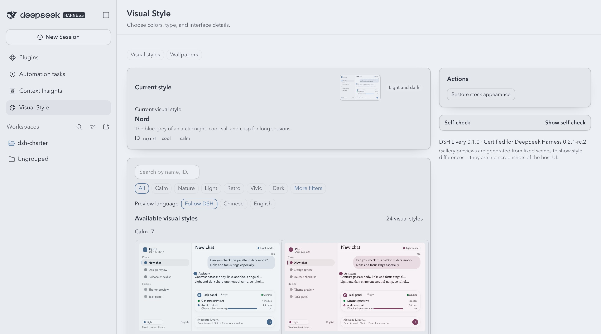
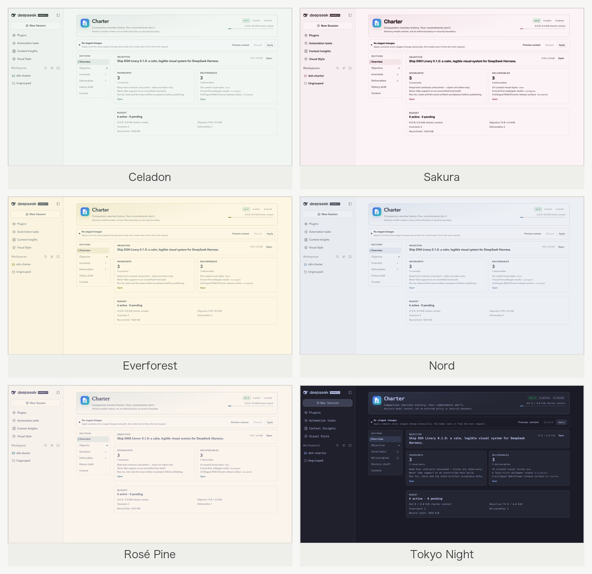
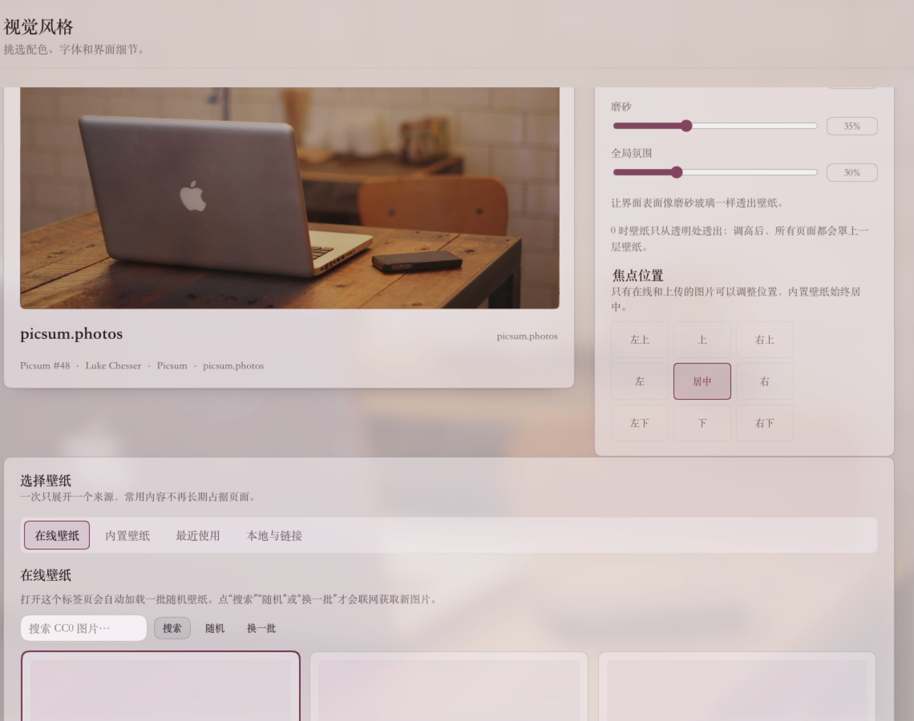

# DSH Livery (dsh-livery)

[](LICENSE)
[](https://www.npmjs.com/package/dsh-livery)
[](package.json)
[](#host-support-and-version-policy)

> **Make your DSH beautiful to look at — and alive to use.**

A visual layer for DeepSeek Harness: **24 curated styles**, a wallpaper studio with
online search and blur/frost effects, and a style gallery. It is a plugin, not a
host theme takeover.

> **Release status: 0.1.4 limited release.**
>
> **Stable certified:** DSH `0.2.1-rc.2` + Web Profile + Chrome 156.0.8078.48 + Node 22.23.1,
> and DSH `0.2.1-rc.3` + Desktop app on macOS + its Electron/Node 24 runtime.
>
> **Next-channel preview:** DSH `0.2.1-rc.4` + Web Profile + Chrome 156.0.8078.48 + Node
> 22.23.1. The official npm package is signed and the exact tarball is in the
> acceptance evidence, but upstream has not yet published a matching GitHub
> tag/release; this is compatibility preview, not a stability promise for a
> pre-release channel.
>
> Desktop Windows, Web Edge and other DSH builds are outside the supported scope.
> Other DSH versions are rejected at install/runtime and fail closed. The
> publishable artifact is bound to committed acceptance evidence;
> `prepublish-check` refuses mismatched bytes.

English · [中文](README.zh-CN.md)



All screenshots come from a real Web profile (the captures show the Chinese UI;
Livery follows the DSH host locale). The style montage uses the shipped fixed
preview scenes; the rest show DSH Livery's own UI and real online wallpaper loads.

## Features

- **24 styles across five visual axes.** Colour (OKLab seeds → complete light/dark
  tokens), typography (10 local-only font stacks and 9 typography profiles), module
  shape (`--dsw-radius-*`, `--dsw-corner-shape`), elevation/material (flat or paper
  hairline panels, elevated cards, glass blur), and border/focus treatment. The set
  includes 10 original designs, 12 palettes inspired by permissively licensed
  projects (MIT/Apache-2.0; see [NOTICE](NOTICE.md)), and 2 original Chinese designs
  (Celadon 青瓷, Cinnabar 朱砂).
- **Wallpaper studio.** 24 built-in CSS wallpapers plus one **Choose wallpaper**
  area with Online, Built-in, Recent, and Local & link source tabs. Opening the
  wallpaper tab loads one random Picsum batch automatically; search Openverse
  (CC0/PDM), draw another random batch, or load the next one. Local image upload
  (stored in IndexedDB) and https URLs share the Local & link tab. Effects: blur
  0–24 px, dim 0–70 %, frost 0–100 %, and a global atmosphere overlay. The
  atmosphere layer is intentionally below all floating UI (menus, tooltips,
  dialogs, toasts), so it adds page tint only where the page layering permits it;
  opaque third-party plugin pages may show no perceptible change. Both wallpaper
  layers are viewport-relative `cover`, so portrait, ultrawide and resized windows
  crop instead of distorting. Network requests start when you open the tab or take
  an explicit action; your choices stay local.
- **Presets, focal position and window sync.** Export/import a lightweight
  appearance preset containing an existing style, a builtin/https wallpaper, the
  four effects and a nine-grid focal point; presets never contain uploaded image
  blobs, CSS, tokens, fonts, local paths or history. Remote/upload wallpapers gain
  a keyboard-operable focal position, wallpaper choices sync live between tabs in
  the same Web Profile, and a local-data cleanup action reports what was removed.
- **Workbench-first studio with one type scale.** The style page opens with a large
  current-style hero (preview, apply/cancel and restore actions) followed by a
  full-width gallery with a two-row toolbar. The wallpaper page pairs a current
  wallpaper preview with a compact effects card, then one tabbed source-picker card;
  presets and local-data cleanup live in a collapsed management area. One five-step
  type scale (22/16/14/13/12 px) and container-query layout are shared across modules.
- **Style gallery.** Six families (Calm / Nature / Light / Retro / Vivid / Dark);
  a single-row search/category toolbar, full tag set under "More filters", and a
  preview-language control that switches thumbnails between Follow DSH, Chinese and
  English. Style cards use a consistent 16:10 preview without repeated light/dark chips.
- **Sidebar entry.** A left-sidebar plugin panel (**Visual Style**, with a second
  **Wallpapers** tab), next to Plugins / Automation / Context.
- **Missing features are reported.** Missing host capabilities and unverified modes
  are shown in the self-check instead of being faked.

## Styles



Six of the 24 styles: **Celadon, Sakura, Everforest, Nord, Rosé Pine, Tokyo Night**.
These are the shipped fixed preview scenes (not host UI captures); the same
previews appear in the 0.1.4 full-width gallery.

## Wallpapers




Captured in DSH Livery's own wallpaper studio: a real online Picsum #48 image
loaded from the Online tab, with focal position and the four source tabs visible.

## Why another skin plugin is different

| Typical skin plugin | DSH Livery |
|---|---|
| Takes over `ctx.theme`, registers theme ids, calls `setTheme` | Emits one scoped semantic token pair per style; never registers or owns a host theme |
| Paints window chrome | Draws no chrome; the host owns the window |
| Broad selector CSS that breaks when the host refactors | Token-only CSS plus a body-scoped wallpaper layer; no host component selectors |
| Breaks after DSH updates | Exact-version support matrix; unknown hosts fail closed instead of guessing |
| "Trust me" theming | Frozen contract hashes, loader-ABI checks, contrast/CSS audits and committed acceptance evidence |

## Host support and version policy

`engines.dsh` is the exact allowlist **`0.2.1-rc.2 || 0.2.1-rc.3 || 0.2.1-rc.4`**.
The supported scope is deliberately narrow:

| Host | Profile / platform | Runtime | Status |
|---|---|---|---|
| DSH `0.2.1-rc.2` | Web Profile, Chrome 156.0.8078.48 | Node 22.23.1 | **Stable certified** (npm `latest`) |
| DSH `0.2.1-rc.4` | Web Profile, Chrome 156.0.8078.48 | Node 22.23.1 | **Next-channel preview** (npm `next`; GitHub prerelease tag exists) |
| DSH `0.2.1-rc.3` | Desktop app, macOS | Electron/Node 24.21.0 · Chromium 152.0.7977.130 | **Stable certified** renderer surface (GitHub-tagged) |
| Desktop Windows, Web Edge, other DSH builds | — | — | Not supported; no guarantee |

There is no compatibility mode. A different DSH version is rejected at install time
and fails closed at runtime. Stable support is claimed only for host releases that
have a **non-prerelease official GitHub release** and the matching signed package
on npm's `latest` channel (currently `0.2.1-rc.2` and `0.2.1-rc.3`). The
`0.2.1-rc.4` adapter was verified against the signed official npm tarball from the
`next` channel. Upstream now has a GitHub **prerelease** tag
`dsh-v0.2.1-rc.4`, but the GitHub release is not a formal release and the npm
dist-tag is still `next`, so it remains preview compatibility and may be removed
or re-certified if upstream withdraws or promotes it.

The Desktop certification covers plugin install, boot, renderer, settings/gallery,
persistence and the first-frame handshake; native macOS window chrome, traffic
lights/leading, vibrancy, Dock/rightbar and OS-level DPI are host-owned and outside
the plugin's certification surface. The formal matrix lives at
`contracts/dsh/support-matrix.json`; see
[docs/verification.md](docs/verification.md) for all evidence files.

## Install

Published package: [`dsh-livery@0.1.4`](https://www.npmjs.com/package/dsh-livery).

### Web Profile (CLI)

```bash
dsh plugin --profile web add dsh-livery@0.1.4
dsh web                                 # open the URL printed by dsh
```

### Desktop app

The Desktop app installs plugins from its plugin manager:
**Settings → Plugins → Install by package name**, then enter
`dsh-livery@0.1.4`. The `0.2.1-rc.3` Desktop runtime is accepted by this release;
the plugin installs and runs in the Electron renderer. Native macOS window chrome,
traffic lights/leading, vibrancy, Dock/rightbar and OS-level DPI are host-owned and
outside the plugin's certification surface.

#### Local npm tarball fallback (new-release age window)

The Desktop plugin manager applies a minimum-release-age/supply-chain check. A
version published less than ~24 hours ago can be rejected even though it is
valid. To install immediately, download the exact npm tarball locally and install
that file:

```bash
npm pack dsh-livery@0.1.4 --pack-destination "$HOME/Downloads"
shasum -a 256 "$HOME/Downloads/dsh-livery-0.1.4.tgz"
# Compare this hash with the GitHub Release / npm artifact hash before installing.
"/Applications/DeepSeek Harness.app/Contents/Resources/runtime/cli/bin/dsh" \
  plugin --profile desktop add "file:$HOME/Downloads/dsh-livery-0.1.4.tgz"
```

Then restart the Desktop app. `npm pack` only downloads the published tarball; it
does not bypass package verification. The local-file path bypasses the registry
age gate, so verify the sha256 against the release artifact and never install an
unverified tarball. The same local-file command is useful for air-gapped or
network-restricted machines.

## Uninstall

Remove the plugin with the DSH plugin manager. DSH keeps the plugin's `livery`
configuration row in the profile; reinstalling may therefore restore the last
applied style. Choose **Restore default appearance** before uninstalling, or remove
the `livery` row from the profile configuration, if you want a clean start.

## Usage

Open the left sidebar and click **Visual Style** above the Workspaces section:

- **Visual styles**: preview (temporary), Apply (single config write), Restore
  default appearance; family sections, search, More filters, and the preview-language
  tab.
- **Wallpapers**: opening the tab loads a random online batch. Search Openverse,
  draw another batch, pick one of 24 built-in designs, upload a local image or paste
  an https URL, then tune blur/dim/frost/atmosphere. For remote and uploaded
  images, choose one of nine focal positions so the crop follows the subject.
  Choices are stored in the browser, survive restarts, and sync to other tabs in
  the same Web Profile. Presets export/import the style + wallpaper + effects +
  focal point; **Clear local wallpaper data** removes uploads and remote caches
  while preserving the currently displayed wallpaper. The atmosphere layer stays
  below floating UI and may not be visibly perceptible on opaque third-party
  plugin pages.

Applying a style and applying a wallpaper are independent: switching styles does
not remove the wallpaper.

## Repository layout

| Path | Contents |
|---|---|
| `src/core` | Colour derivation, contrast, token renderer, registries, style audit |
| `src/compiler` | Manifest validation, previews, audits, compiler CLI |
| `src/host` | Cordis host plugin: exact-version gate, first-frame injection, catalog/preview routes |
| `src/client` | Browser plugin: handshake, runtime, style gallery, wallpaper studio, settings UI |
| `src/contract` | Contract snapshots/diff, adapter generator, support-matrix gate |
| `src/generated` | Committed generated contracts, stock snapshots and compiled catalogs |
| `liveries/` | 24 built-in style manifests (`schemas/livery.schema.json`) |
| `contracts/` | Frozen host contract snapshots and the formal support matrix |
| `scripts/` | Build/CLI tooling and the browser acceptance harness |
| `tests/` | Unit, compiler, host, client, contract and browser-harness suites |
| `docs/` | Design docs, research notes, README screenshots and verification summary |

## Development

Requirements: Node `^22.23.1 || ^24.21.0`, pnpm 12.

```bash
pnpm install
pnpm verify          # typecheck + tests + generated-data check + audits + build + pack check
pnpm lint
pnpm test:loader-abi
pnpm adapter:check
```

Generated contracts, stock snapshots and compiled catalogs are committed, so
`pnpm build` works without a local DSH install.

Browser acceptance (needs a local DSH install, system Chrome and a packed tarball):

```bash
node scripts/acceptance/web.mjs --tgz ./dsh-livery-0.1.4.tgz
node scripts/acceptance/probe/desktop-probe.mjs --tgz ./dsh-livery-0.1.4.tgz
node tests/browser/run.mjs --tgz ./dsh-livery-0.1.4.tgz      # thin wrapper
```

## Verification

For 0.1.4: Web `0.2.1-rc.2` isolated full run, latest Web `0.2.1-rc.4` isolated
run, and Desktop `0.2.1-rc.3` real Electron install/renderer acceptance all pass (exact certified Chrome build; official
Chrome for Testing is used when the system channel has moved past the pinned
version)
with **0 failures** on the exact certified runtime matrix (Chrome 156.0.8078.48 / Node 22.23.1 for Web; Electron/Node
24.21.0 for Desktop). Exact counts and report hashes are in the committed evidence
files. Repo gates include `tsc`, the full test suite, contrast / token / CSS
audits, loader ABI and package checks. The exact artifact is bound to
`contracts/dsh/evidence/0.1.4/0.2.1-rc.2-web-chrome.json`,
`contracts/dsh/evidence/0.1.4/0.2.1-rc.4-web-chrome.json` and
`contracts/dsh/evidence/0.1.4/0.2.1-rc.3-desktop-macos.json`. Details and known
limitations: [docs/verification.md](docs/verification.md).

## Contributing

- [Contributing guide](CONTRIBUTING.md) · [贡献指南](CONTRIBUTING.zh-CN.md)
- [Code of Conduct](CODE_OF_CONDUCT.md) · [Security policy](SECURITY.md) · [Support](SUPPORT.md)

Commits are one concise line (`feat:`, `fix:`, `docs:`, `test:`, `chore:`).

## Documentation

- [Docs index](docs/README.md)
- Design: [interfaces](docs/design/interfaces.md) · [style system](docs/design/style-system.md) · [multi-version policy](docs/design/multi-version.md)
- Research: [design references](docs/research/design-references.md)
- [Verification summary](docs/verification.md)

## License

MIT, see [LICENSE](LICENSE). Palette attributions are in [NOTICE.md](NOTICE.md).
Preview thumbnails and built-in wallpapers are generated from the plugin's own data.
The optional wallpaper studio loads online images only when you open the wallpaper
tab or take an explicit action (see [SECURITY.md](SECURITY.md)).
