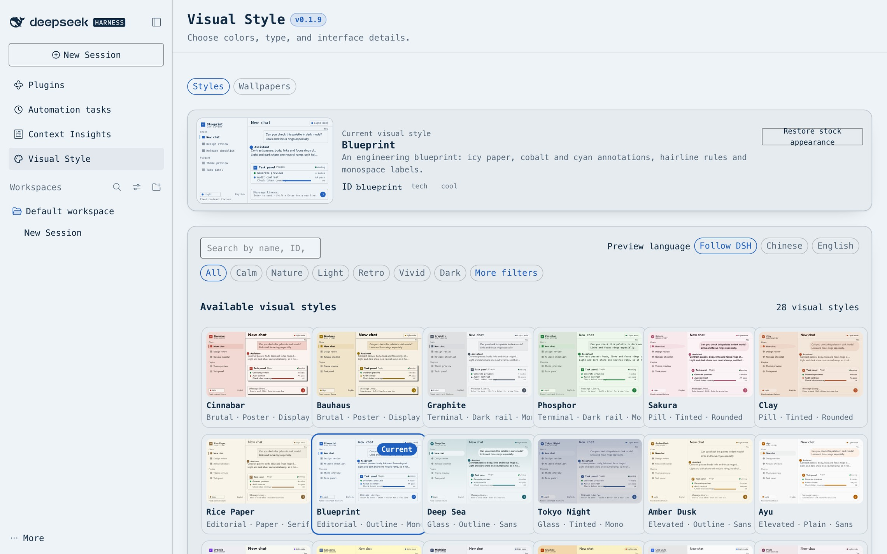
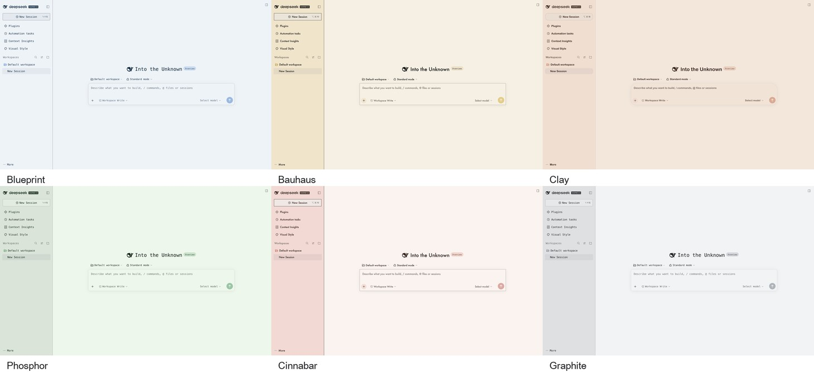
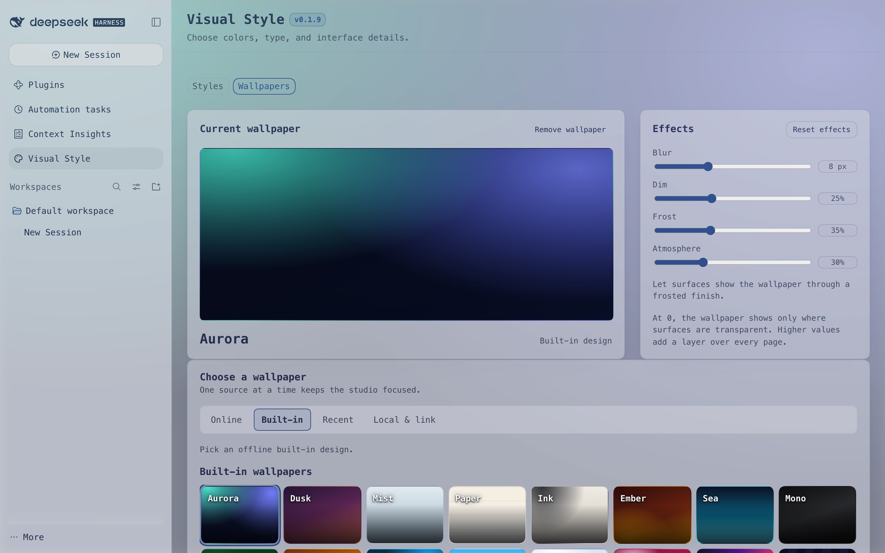
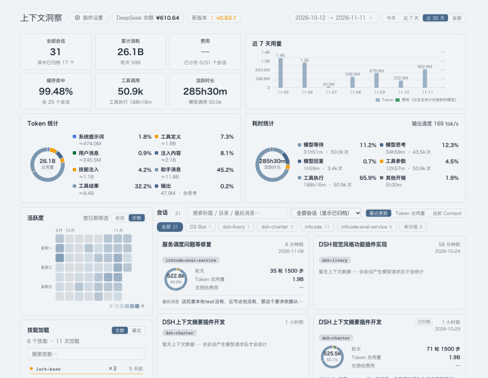

# DSH Livery (dsh-livery)

[](LICENSE)
[](https://www.npmjs.com/package/dsh-livery)
[](package.json)
[](#supported-dsh-builds)

> **Make your DSH beautiful to look at — and alive to use.**

A visual layer for DeepSeek Harness: **28 curated styles**, a wallpaper studio with
online images and blur/frost effects, and a style gallery. It is a plugin, not a
host theme takeover.

> **Release status: 0.1.9 — release candidate, pending manual acceptance.**
> `0.1.9` adds four GUI-first palettes (Blueprint, Bauhaus, Clay, Phosphor), an
> optional component-chrome axis, a compact 28-style catalog with style-DNA labels,
> and the macOS sidebar frost parity fix. It is not published yet; `0.1.8` remains
> the current npm release until the candidate is accepted and promoted.
>
> **Stable certified:** DSH `0.2.1-rc.2` + Web Profile, and DSH `0.2.1-rc.3` +
> macOS Desktop. **Preview:** DSH `0.2.1-rc.4` Web, DSH `0.2.1-rc.5` Web/Desktop,
> DSH `0.2.2-rc.1` Web/Desktop and DSH `0.2.2-rc.2` Web/Desktop. `0.2.2-rc.2` is
> npm `next` and a GitHub prerelease, so it remains a preview claim. Compatible
> 0.2.x builds outside the exact matrix may run in diagnosed compatible-preview
> mode; Windows Desktop, Edge and other DSH builds remain unsupported.

English · [中文](README.zh-CN.md)



Screenshots use the Chinese UI; Livery follows the DSH host locale. The style
showcase uses a real online Picsum wallpaper, not a built-in default.

## What's new in 0.1.9

- **A compact catalog, not a hero-plus-scroll.** The current style is a 220×138
  summary bar; 28 styles sit in one continuous 6/4/3/2-column grid, with the
  family chips as the only taxonomy. At 1440 the catalog scroll drops from about
  2,788 px to 1,480 px.
- **Style DNA on every card.** Each card names its surface recipe, component
  chrome and UI type family, and the default order starts with the most distinct
  GUI shapes instead of a run of similar cards.
- **Four new GUI-first palettes.** Blueprint (engineering cyan + mono + editorial),
  Bauhaus (mustard/cobalt + display + brutal/poster), Clay (terracotta + rounded +
  pill/tinted), Phosphor (green CRT + terminal). The set grows from 24 to 28.
- **Component chrome.** `layout.chrome` can tint, outline, darken or block-fill the
  rail, composer, bubble, active row and selector from the palette seeds; six
  recipes ship and all 28 styles choose one.
- **macOS sidebar frost parity.** The wallpaper stylesheet now authors
  `--dsw-specific-sidebar-tint` at the same frost ratio as the main column, so a
  light wallpaper no longer washes out the left rail.

## What's new in 0.1.7

- **Online result thumbnails are back.** The Online tab now renders each provider
  thumbnail as an image, with the local skeleton visible while loading and as the
  fallback if the image fails. Previously only the skeleton was rendered, so a
  healthy list looked blank until a card was clicked.
- **Included from 0.1.6:** DSH `0.2.2-rc.1` Web/Desktop support, equal-height 1440
  workbench cards, single-column 1024/767 layout, the `v0.1.7` title badge and
  online-wallpaper-first visual/README verification.
- **One surface system across DSH plugins.** Host plugin pages such as Trajectory,
  Context and Agent Team inherit the same livery layer elevation and palette tokens;
  third-party data views use the same accent instead of stock chart colours.
- **Documentation discipline.** Design-critical changes carry a versioned design
  note under `docs/design/`; README, SECURITY, support matrix and CHANGELOG are
  updated as one release set.

## Features

- **28 styles across six visual axes.** Colour (OKLab seeds → complete light/dark
  tokens), typography (10 local-only font stacks and 9 typography profiles), shape,
  elevation/material, border/focus treatment and component chrome. The set includes
  14 original designs, 12 permissively licensed palettes and 2 original Chinese
  designs.
- **Wallpaper studio.** Online Picsum/Openverse sources, 24 built-in CSS wallpapers,
  Recent, and Local & link uploads (IndexedDB). Blur 0–24 px, dim 0–70 %, frost
  0–100 % and a global atmosphere overlay. The two painted wallpaper layers are
  viewport-relative `cover`, so images crop without geometric distortion.
- **Presets and focal position.** Export/import style + wallpaper + effects +
  nine-grid focal point; remote/upload wallpapers support pointer and keyboard
  focal positioning. Presets never contain uploaded blobs, CSS, tokens or paths.
- **Workbench UI.** A style page with a compact current-style summary and a dense
  continuous catalog, a
  wallpaper page with current wallpaper, effects and a four-tab source picker, and
  a collapsed management area for presets and local-data cleanup.
- **Trust by construction.** Exact host allowlist, frozen contracts, token-only
  CSS, loader-ABI checks, contrast/CSS audits and committed acceptance evidence.
  Unknown hosts are rejected at install and fail closed to stock at runtime.

## Styles



Six of the 28 styles: **Celadon, Sakura, Everforest, Nord, Rosé Pine, Tokyo Night**.
These are shipped fixed preview scenes; the live gallery renders the same previews.

## Wallpapers



A real online Picsum photo loaded from the Online tab, with focal position and the
four source tabs. Opening the tab loads one random batch; search, randomise, page
or switch source explicitly. Wallpaper choices stay local.

## Every DSH plugin page



The Trajectory, Context, Agent Team and built-in studio pages share one
implementation: the livery layer ladder gives cards/tables/overlays a visible
elevation above the page base, and third-party chart palette variables resolve to
the active livery tokens. No per-plugin selectors or hashed host classes.

## Supported DSH builds

`engines.dsh` is the reviewed 0.2 compatibility range:

```text
>=0.2.1-rc.2 <0.3.0
```

Exact certified builds remain the formal matrix and evidence authority. Newer
0.2 builds with matching loader/host/client API hashes may load the newest
certified adapter in compatible-preview mode with a visible diagnostic warning.

| Host build | Entry | Runtime | Status |
|---|---|---|---|
| DSH `0.2.1-rc.2` | Web Profile + Chrome `156.0.8078.48` | Node `22.23.1` | **Stable certified** (npm `latest`) |
| DSH `0.2.1-rc.3` | macOS Desktop app | Electron `44.7.0` / Node `24.21.0` / Chromium `152.0.7977.130` | **Stable certified** renderer surface |
| DSH `0.2.1-rc.4` | Web Profile + Chrome `156.0.8078.48` | Node `22.23.1` | **Next-channel preview** |
| DSH `0.2.1-rc.5` | Web + macOS Desktop | Node `22.23.1` / `24.21.0` | **Preview** |
| DSH `0.2.2-rc.1` | Web + macOS Desktop | Node `24.22.1` / `24.21.0` | **Preview** |
| DSH `0.2.2-rc.2` | Web + macOS Desktop | Node `24.22.1` / `24.21.0` | **Preview** (npm `next`) |
| DSH `0.2.2-rc.3` | macOS Desktop app | Electron `44.7.0` / Node `24.21.0` / Chromium `152.0.7977.130` | **Preview** (npm `next`); Desktop accepted, Web pending |

Compatible-preview mode is not a stability claim; 0.3+ and API-divergent builds
still fail closed. Stable support requires a non-prerelease official GitHub
release plus the matching signed npm package on `latest`; npm `next` and GitHub
prereleases are preview claims, not stability promises. Native macOS window chrome,
traffic lights, vibrancy, Dock/rightbar states and OS-level DPI are host-owned and
outside plugin certification. Full policy: [docs/design/multi-version.md](docs/design/multi-version.md).

## Install

Latest published package: [`dsh-livery@0.1.8`](https://www.npmjs.com/package/dsh-livery).
The `0.1.9` candidate is local-only until manual acceptance; install its tarball
with the official plugin-manager path when testing.

### Web Profile

```bash
dsh plugin --profile web add dsh-livery@0.1.8
dsh web
```

### Desktop app

Open **Settings → Plugins → Install by package name** and enter
`dsh-livery@0.1.8`, or use the app-bundled CLI:

```bash
"/Applications/DeepSeek Harness.app/Contents/Resources/runtime/cli/bin/dsh" \
  plugin --profile desktop add dsh-livery@0.1.8
```

If the registry age window rejects a fresh release, download the exact tarball,
verify its sha256 against the release, and install that file instead. Never install
an unverified tarball.

## Verification

The published `0.1.8` artifact passed full isolated acceptance on Web `0.2.1-rc.2`,
`0.2.1-rc.4`, `0.2.1-rc.5`, `0.2.2-rc.1`, `0.2.2-rc.2` with **275 passed / 0 failed
each**, and Desktop `0.2.1-rc.3`, `0.2.1-rc.5`, `0.2.2-rc.1`, `0.2.2-rc.2` with
**34 / 0 each**. The `0.1.9` candidate is under manual acceptance; its evidence
will be bound under `contracts/dsh/evidence/0.1.9/` before promotion. Scope,
counts and limitations: [docs/verification.md](docs/verification.md).

Release gates include `tsc`, the full test suite, token/contrast/CSS audits,
loader-ABI checks, exact support-matrix / release gates, `release:prepare` and
`prepublish-check`. The publish workflow never rebuilds the accepted tarball.

## Documentation

- [Docs index](docs/README.md)
- Design: [interfaces](docs/design/interfaces.md) · [style system](docs/design/style-system.md) · [wallpaper workbench](docs/design/wallpaper-workbench.md) · [multi-version policy](docs/design/multi-version.md)
- [Verification summary](docs/verification.md)
- [CHANGELOG](CHANGELOG.md) · [SECURITY](SECURITY.md) · [SUPPORT](SUPPORT.md)

## License

MIT, see [LICENSE](LICENSE). Palette attributions are in [NOTICE.md](NOTICE.md).
Preview thumbnails and built-in wallpapers are generated from the plugin's own data.
The optional wallpaper studio loads online images only when you open the wallpaper
tab or take an explicit action (see [SECURITY.md](SECURITY.md)).
