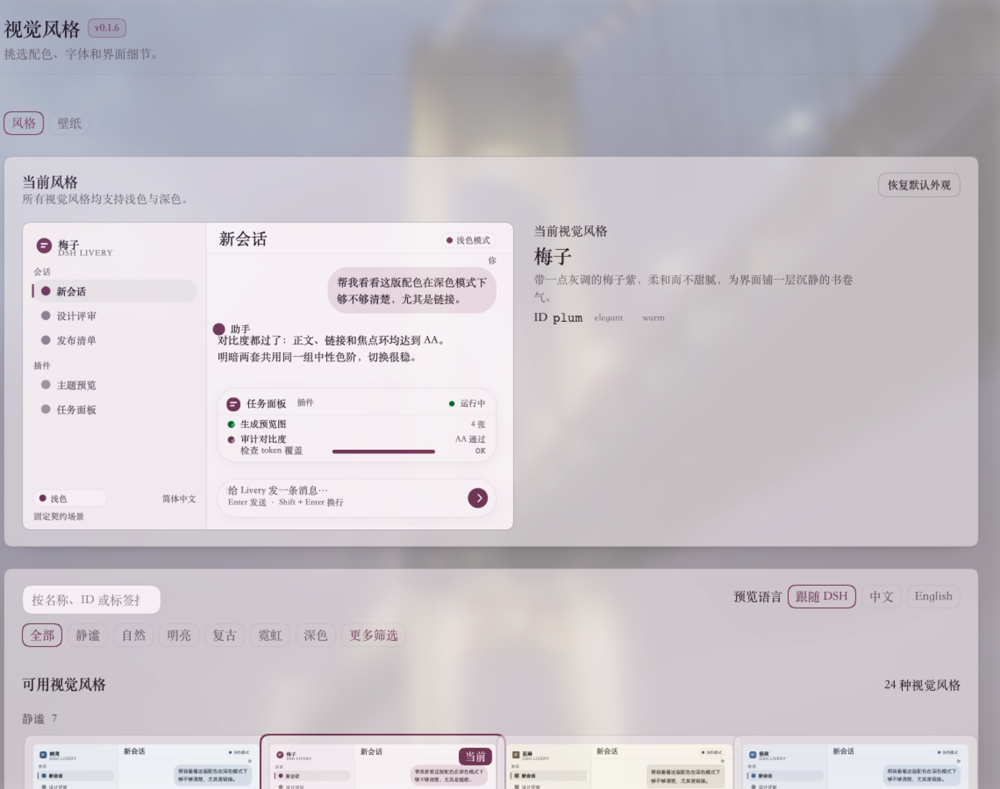
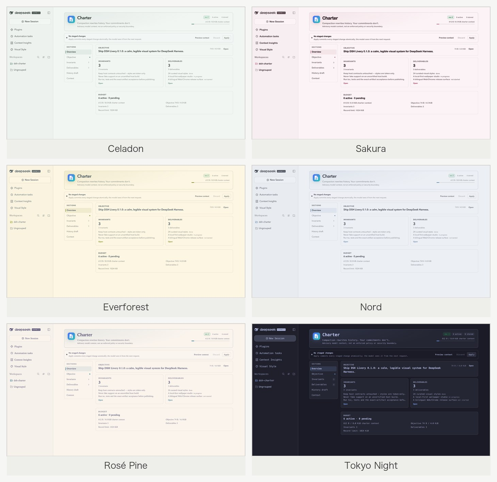
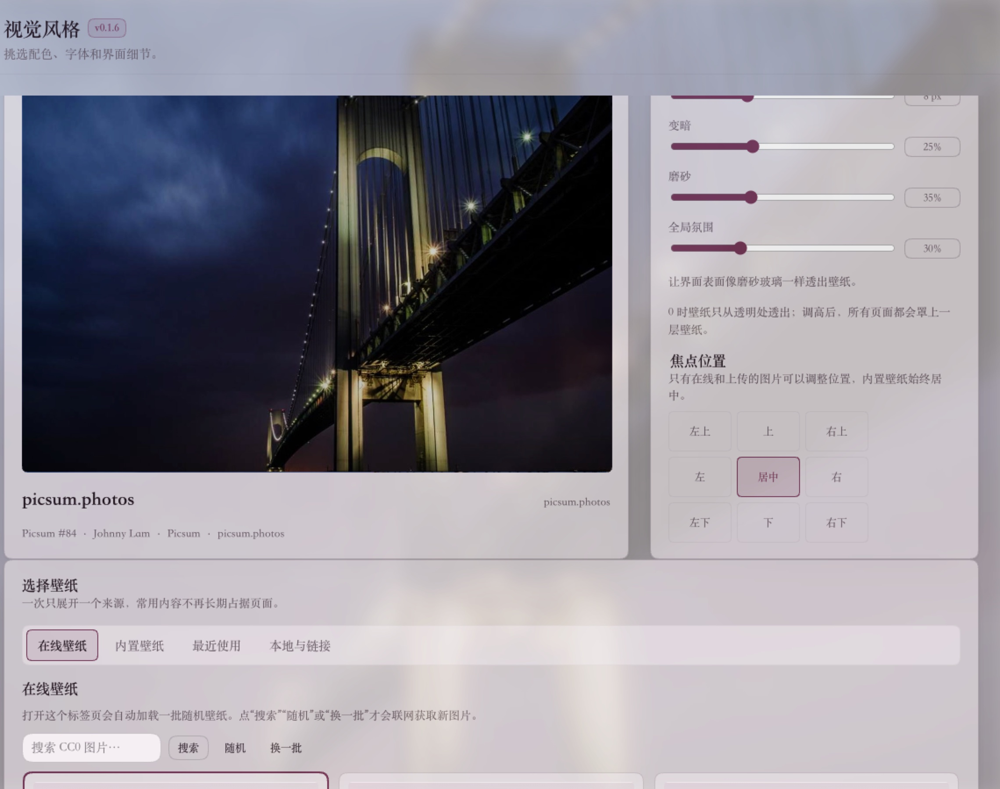

# DSH Livery (dsh-livery)

[](LICENSE)
[](https://www.npmjs.com/package/dsh-livery)
[](package.json)
[](#supported-dsh-builds)

> **Make your DSH beautiful to look at — and alive to use.**

A visual layer for DeepSeek Harness: **24 curated styles**, a wallpaper studio with
online images and blur/frost effects, and a style gallery. It is a plugin, not a
host theme takeover.

> **Release status: 0.1.7 release candidate.** `0.1.6` is the latest npm release
> and includes DSH `0.2.2-rc.1` Web/Desktop support and the workbench layout work.
> `0.1.7` is a small hotfix candidate that restores online-wallpaper result
> thumbnails. It is not published yet.
>
> **Stable certified:** DSH `0.2.1-rc.2` + Web Profile, and DSH `0.2.1-rc.3` +
> macOS Desktop. **Preview:** DSH `0.2.1-rc.4` Web, DSH `0.2.1-rc.5` Web/Desktop,
> and DSH `0.2.2-rc.1` Web/Desktop. `0.2.2-rc.1` is now npm `latest`, but its GitHub
> release is still a prerelease, so it remains a preview claim. Windows Desktop,
> Edge and other DSH builds are unsupported and fail closed.

English · [中文](README.zh-CN.md)



Screenshots use the Chinese UI; Livery follows the DSH host locale. The style
showcase uses a real online Picsum wallpaper, not a built-in default.

## What's new in 0.1.7

- **Online result thumbnails are back.** The Online tab now renders each provider
  thumbnail as an image, with the local skeleton visible while loading and as the
  fallback if the image fails. Previously only the skeleton was rendered, so a
  healthy list looked blank until a card was clicked.
- **Included from 0.1.6:** DSH `0.2.2-rc.1` Web/Desktop support, equal-height 1440
  workbench cards, single-column 1024/767 layout, the `v0.1.7` title badge and
  online-wallpaper-first visual/README verification.
- **Documentation discipline.** Design-critical changes carry a versioned design
  note under `docs/design/`; README, SECURITY, support matrix and CHANGELOG are
  updated as one release set.

## Features

- **24 styles across five visual axes.** Colour (OKLab seeds → complete light/dark
  tokens), typography (10 local-only font stacks and 9 typography profiles), shape,
  elevation/material and border/focus treatment. The set includes 10 original
  designs, 12 permissively licensed palettes and 2 original Chinese designs.
- **Wallpaper studio.** Online Picsum/Openverse sources, 24 built-in CSS wallpapers,
  Recent, and Local & link uploads (IndexedDB). Blur 0–24 px, dim 0–70 %, frost
  0–100 % and a global atmosphere overlay. The two painted wallpaper layers are
  viewport-relative `cover`, so images crop without geometric distortion.
- **Presets and focal position.** Export/import style + wallpaper + effects +
  nine-grid focal point; remote/upload wallpapers support pointer and keyboard
  focal positioning. Presets never contain uploaded blobs, CSS, tokens or paths.
- **Workbench UI.** A style page with a current-style hero and full gallery, a
  wallpaper page with current wallpaper, effects and a four-tab source picker, and
  a collapsed management area for presets and local-data cleanup.
- **Trust by construction.** Exact host allowlist, frozen contracts, token-only
  CSS, loader-ABI checks, contrast/CSS audits and committed acceptance evidence.
  Unknown hosts are rejected at install and fail closed to stock at runtime.

## Styles



Six of the 24 styles: **Celadon, Sakura, Everforest, Nord, Rosé Pine, Tokyo Night**.
These are shipped fixed preview scenes; the live gallery renders the same previews.

## Wallpapers



A real online Picsum photo loaded from the Online tab, with focal position and the
four source tabs. Opening the tab loads one random batch; search, randomise, page
or switch source explicitly. Wallpaper choices stay local.

## Supported DSH builds

`engines.dsh` is the exact allowlist:

```text
0.2.1-rc.2 || 0.2.1-rc.3 || 0.2.1-rc.4 || 0.2.1-rc.5 || 0.2.2-rc.1
```

| Host build | Entry | Runtime | Status |
|---|---|---|---|
| DSH `0.2.1-rc.2` | Web Profile + Chrome `156.0.8078.48` | Node `22.23.1` | **Stable certified** (npm `latest`) |
| DSH `0.2.1-rc.3` | macOS Desktop app | Electron `44.7.0` / Node `24.21.0` / Chromium `152.0.7977.130` | **Stable certified** renderer surface |
| DSH `0.2.1-rc.4` | Web Profile + Chrome `156.0.8078.48` | Node `22.23.1` | **Next-channel preview** |
| DSH `0.2.1-rc.5` | Web + macOS Desktop | Node `22.23.1` / `24.21.0` | **Preview** |
| DSH `0.2.2-rc.1` | Web + macOS Desktop | Node `24.22.1` / `24.21.0` | **Preview** |

There is no compatibility mode. A different DSH version is rejected at install and
fails closed at runtime. Stable support requires a non-prerelease official GitHub
release plus the matching signed npm package on `latest`; npm `next` and GitHub
prereleases are preview claims, not stability promises. Native macOS window chrome,
traffic lights, vibrancy, Dock/rightbar states and OS-level DPI are host-owned and
outside plugin certification. Full policy: [docs/design/multi-version.md](docs/design/multi-version.md).

## Install

Latest published package: [`dsh-livery@0.1.6`](https://www.npmjs.com/package/dsh-livery).

### Web Profile

```bash
dsh plugin --profile web add dsh-livery@0.1.6
dsh web
```

### Desktop app

Open **Settings → Plugins → Install by package name** and enter
`dsh-livery@0.1.6`, or use the app-bundled CLI:

```bash
"/Applications/DeepSeek Harness.app/Contents/Resources/runtime/cli/bin/dsh" \
  plugin --profile desktop add dsh-livery@0.1.6
```

If the registry age window rejects a fresh release, download the exact tarball,
verify its sha256 against the release, and install that file instead. Never install
an unverified tarball.

### 0.1.7 candidate

`0.1.7` is not on npm yet. Test the exact candidate locally:

```bash
dsh plugin --profile web add "file:./dsh-livery-0.1.7.tgz"
```

Exact sha256, bytes and run identity are in
`contracts/dsh/evidence/0.1.7/`.

## Verification

Full isolated acceptance passed on the exact candidate for Web `0.2.1-rc.2`,
`0.2.1-rc.4`, `0.2.1-rc.5`, `0.2.2-rc.1` and Desktop `0.2.1-rc.3`, `0.2.1-rc.5`,
`0.2.2-rc.1`, with **0 failures**. The 0.1.7 evidence files are under
`contracts/dsh/evidence/0.1.7/`, and the scope,
counts and limitations are in [docs/verification.md](docs/verification.md).

Release gates include `tsc`, the full test suite, token/contrast/CSS audits,
loader-ABI checks, exact support-matrix / release gates, `release:prepare` and
`prepublish-check`. The publish workflow never rebuilds the accepted tarball.

## Documentation

- [Docs index](docs/README.md)
- Design: [interfaces](docs/design/interfaces.md) · [style system](docs/design/style-system.md) · [wallpaper workbench](docs/design/wallpaper-workbench.md) · [multi-version policy](docs/design/multi-version.md)
- [Verification summary](docs/verification.md)
- [CHANGELOG](CHANGELOG.md) · [SECURITY](SECURITY.md) · [SUPPORT](SUPPORT.md)

## License

MIT, see [LICENSE](LICENSE). Palette attributions are in [NOTICE.md](NOTICE.md).
Preview thumbnails and built-in wallpapers are generated from the plugin's own data.
The optional wallpaper studio loads online images only when you open the wallpaper
tab or take an explicit action (see [SECURITY.md](SECURITY.md)).
