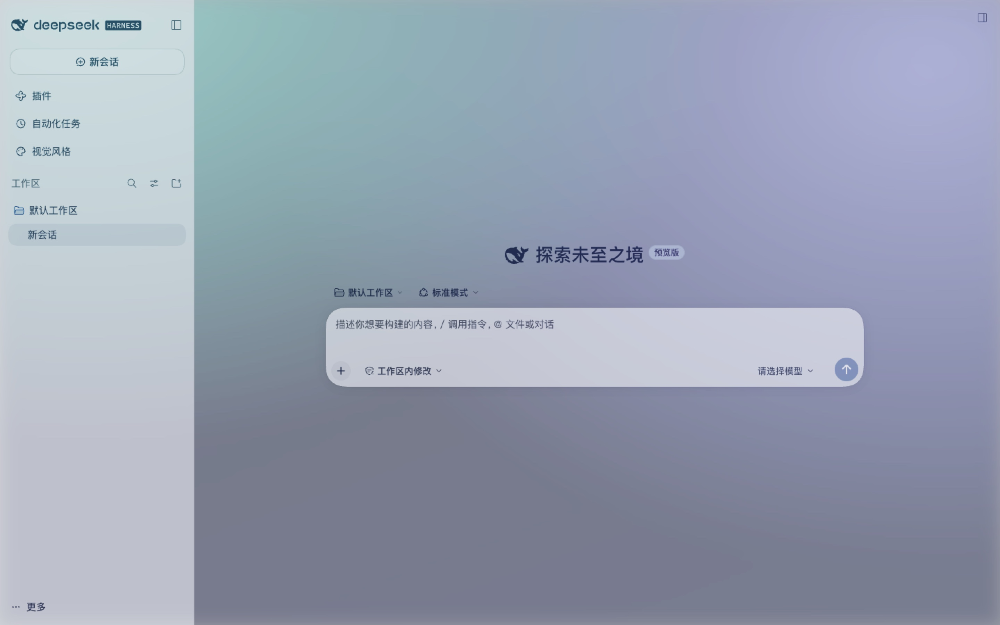

# DSH Livery (dsh-livery)

[](LICENSE)
[](https://www.npmjs.com/package/dsh-livery)
[](package.json)
[](#host-support-and-version-policy)

> **Make your DSH beautiful to look at — and alive to use.**

A visual layer for DeepSeek Harness: **24 curated styles**, a wallpaper studio with
online search and blur/frost effects, and a style gallery. It is a plugin, not a
host theme takeover.

> **Release status: 0.1.0 limited release.** Supported exactly for DSH
> `0.2.1-rc.2` + Web Profile + Chrome 155. Desktop macOS/Windows and Web Edge are
> outside the supported scope (no support or guarantee). Other DSH builds are
> rejected at install/runtime and fail closed. The publishable artifact is bound to
> committed acceptance evidence; `prepublish-check` refuses mismatched bytes.

English · [中文](README.zh-CN.md)


All screenshots come from a real Web profile. The style montage and the
wallpaper-coverage image use [dsh-charter](https://github.com/centella-cream/dsh-charter)
— a separate bilingual session-charter plugin — as an example of another plugin's
page being styled; the rest show DSH Livery's own UI.

## Features

- **24 styles across five visual axes.** Colour (OKLab seeds → complete light/dark
  tokens), typography (10 local-only font stacks and 9 typography profiles), module
  shape (`--dsw-radius-*`, `--dsw-corner-shape`), elevation/material (flat or paper
  hairline panels, elevated cards, glass blur), and border/focus treatment. The set
  includes 10 original designs, 12 palettes inspired by permissively licensed
  projects (MIT/Apache-2.0; see [NOTICE](NOTICE.md)), and 2 original Chinese designs
  (Celadon 青瓷, Cinnabar 朱砂).
- **Wallpaper studio.** 24 built-in CSS wallpapers and an **online wallpapers** card.
  Opening the wallpaper tab loads one random Picsum batch automatically; search
  Openverse (CC0/PDM), draw another random batch, or load the next one. Local image
  upload (stored in IndexedDB) and https URLs are also supported. Effects: blur
  0–24 px, dim 0–70 %, frost 0–100 %, and a global atmosphere overlay that keeps the
  wallpaper visible on **every** plugin page. Both layers are viewport-relative
  `cover`, so portrait, ultrawide and resized windows crop instead of distorting.
  Network requests start when you open the tab or take an explicit action; your
  choices stay local.
- **Card-based studio with one type scale.** Both pages use responsive cards. The
  style page pairs a current-style card with a gallery card and an Actions /
  Self-check rail; the wallpaper page has a preview, a search-first online card, a
  custom upload/URL card, and a side rail with compact bounded effect sliders and the
  24-swatch grid. One five-step type scale is shared across every module.
- **Style gallery.** Six families (Calm / Nature / Light / Retro / Vivid / Dark);
  primary filters first, full tag set under "More filters". A preview-language tab
  switches thumbnails between Follow DSH, Chinese and English.
- **Sidebar entry.** A left-sidebar plugin panel (**Visual Style**, with a second
  **Wallpapers** tab), next to Plugins / Automation / Context.
- **Missing features are reported.** Missing host capabilities and unverified modes
  are shown in the self-check instead of being faked.

## Styles


Six of the 24 styles: **Celadon, Sakura, Everforest, Nord, Rosé Pine, Tokyo Night**.
These captures render on the [dsh-charter](https://github.com/centella-cream/dsh-charter)
Charter page to show how a complete, real plugin page looks when styled; dsh-charter
is a separate bilingual project, not the subject of this README.

## Wallpapers




The studio page on the left is DSH Livery's own UI. The second capture shows the
same Aurora wallpaper applied over the
[dsh-charter](https://github.com/centella-cream/dsh-charter) Charter page, as an
example of another plugin's surface staying covered.

## Why another skin plugin is different

| Typical skin plugin | DSH Livery |
|---|---|
| Takes over `ctx.theme`, registers theme ids, calls `setTheme` | Emits one scoped semantic token pair per style; never registers or owns a host theme |
| Paints window chrome | Draws no chrome; the host owns the window |
| Broad selector CSS that breaks when the host refactors | Token-only CSS plus a body-scoped wallpaper layer; no host component selectors |
| Breaks after DSH updates | Exact-version support matrix; unknown hosts fail closed instead of guessing |
| "Trust me" theming | Frozen contract hashes, loader-ABI checks, contrast/CSS audits and committed acceptance evidence |

## Host support and version policy

`engines.dsh` is the exact version **`0.2.1-rc.2`**. The supported scope is
deliberately narrow:

| Scope | Value |
|---|---|
| DSH build | `0.2.1-rc.2` only |
| Profile | Web Profile |
| Browser | Chrome 155 (the only certified browser version; other Chrome versions are not guaranteed) |
| Desktop macOS/Windows, Web Edge | Not supported, no guarantee; same-version Desktop/Edge may load but are outside certification |
| Older/newer DSH builds | Not supported; rejected at install/runtime and fail closed to stock |

There is no compatibility mode. A different host version is rejected at install
time; a mismatched runtime payload or preview is rejected at runtime. Profile and
browser are support boundaries, not runtime gates: a Desktop/Edge session on the
same DSH build is outside certification and receives no guarantee. The formal
machine-checked scope lives in the repository at `contracts/dsh/support-matrix.json`;
see [docs/verification.md](docs/verification.md) for the accepted evidence.

## Install

Published package: [`dsh-livery@0.1.0`](https://www.npmjs.com/package/dsh-livery).

### Web Profile (CLI)

```bash
dsh plugin --profile web add dsh-livery@0.1.0
dsh web                                 # open the URL printed by dsh
```

### Desktop app

The Desktop app installs plugins from its plugin manager:
**Settings → Plugins → Install by package name**, then enter
`dsh-livery@0.1.0`. This release is certified for Web/Chrome only; the current
Desktop runtime (`0.2.1-rc.3`) does not satisfy this package's
`engines.dsh` (`0.2.1-rc.2`), so the official installer rejects it. Desktop is not a
supported installation target for 0.1.0.

## Uninstall

Remove the plugin with the DSH plugin manager. DSH keeps the plugin's `livery`
configuration row in the profile; reinstalling may therefore restore the last
applied style. Choose **Restore default appearance** before uninstalling, or remove
the `livery` row from the profile configuration, if you want a clean start.

## Usage

Open the left sidebar and click **Visual Style** above the Workspaces section:

- **Visual styles**: preview (temporary), Apply (single config write), Restore
  default appearance; family sections, search, More filters, and the preview-language
  tab.
- **Wallpapers**: opening the tab loads a random online batch. Search Openverse,
  draw another batch, pick one of 24 built-in designs, upload a local image or paste
  an https URL, then tune blur/dim/frost/atmosphere. Choices are stored in the
  browser and survive restarts; the global atmosphere keeps them visible on other
  plugin pages too.

Applying a style and applying a wallpaper are independent: switching styles does
not remove the wallpaper.

## Repository layout

| Path | Contents |
|---|---|
| `src/core` | Colour derivation, contrast, token renderer, registries, style audit |
| `src/compiler` | Manifest validation, previews, audits, compiler CLI |
| `src/host` | Cordis host plugin: exact-version gate, first-frame injection, catalog/preview routes |
| `src/client` | Browser plugin: handshake, runtime, style gallery, wallpaper studio, settings UI |
| `src/contract` | Contract snapshots/diff, adapter generator, support-matrix gate |
| `src/generated` | Committed generated contracts, stock snapshots and compiled catalogs |
| `liveries/` | 24 built-in style manifests (`schemas/livery.schema.json`) |
| `contracts/` | Frozen host contract snapshots and the formal support matrix |
| `scripts/` | Build/CLI tooling and the browser acceptance harness |
| `tests/` | Unit, compiler, host, client, contract and browser-harness suites |
| `docs/` | Design docs, research notes, README screenshots and verification summary |

## Development

Requirements: Node `^22.23.1`, pnpm 12.

```bash
pnpm install
pnpm verify          # typecheck + tests + generated-data check + audits + build + pack check
pnpm lint
pnpm test:loader-abi
pnpm adapter:check
```

Generated contracts, stock snapshots and compiled catalogs are committed, so
`pnpm build` works without a local DSH install.

Browser acceptance (needs a local DSH install, system Chrome and a packed tarball):

```bash
node scripts/acceptance/web.mjs --tgz ./dsh-livery-0.1.0.tgz
node tests/browser/run.mjs --tgz ./dsh-livery-0.1.0.tgz      # thin wrapper
```

## Verification

For the 0.1.0 limited release: Web `0.2.1-rc.2` isolated full run and
real-profile clone both pass with **0 failures** (Chrome 155, macOS arm64); the
clone pass includes a documented clone-only dependency-repair warning. Exact
counts and report hashes are in the committed evidence. Repo gates include `tsc`,
**716 tests (1 optional skip)**, contrast / token / CSS audits, loader ABI and
package checks. The exact artifact is bound to
`contracts/dsh/evidence/0.2.1-rc.2-web-chrome.json`. Details and known limitations:
[docs/verification.md](docs/verification.md).

## Contributing

- [Contributing guide](CONTRIBUTING.md) · [贡献指南](CONTRIBUTING.zh-CN.md)
- [Code of Conduct](CODE_OF_CONDUCT.md) · [Security policy](SECURITY.md) · [Support](SUPPORT.md)

Commits are one concise line (`feat:`, `fix:`, `docs:`, `test:`, `chore:`).

## Documentation

- [Docs index](docs/README.md)
- Design: [interfaces](docs/design/interfaces.md) · [style system](docs/design/style-system.md) · [multi-version](docs/design/multi-version.md) · [visual system v2](docs/design/visual-system-v2.md) · [implementation plan](docs/design/implementation-plan.md)
- Research: [host contract](docs/research/host-contract.md) · [client contract](docs/research/client-contract.md) · [design references](docs/research/design-references.md)
- [Verification summary](docs/verification.md)

## License

MIT, see [LICENSE](LICENSE). Palette attributions are in [NOTICE.md](NOTICE.md).
Preview thumbnails and built-in wallpapers are generated from the plugin's own data.
The optional wallpaper studio loads online images only when you open the wallpaper
tab or take an explicit action (see [SECURITY.md](SECURITY.md)).
