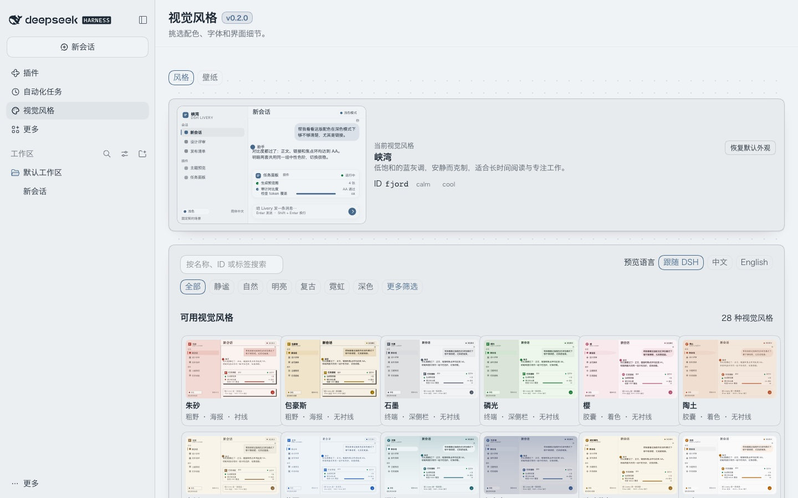
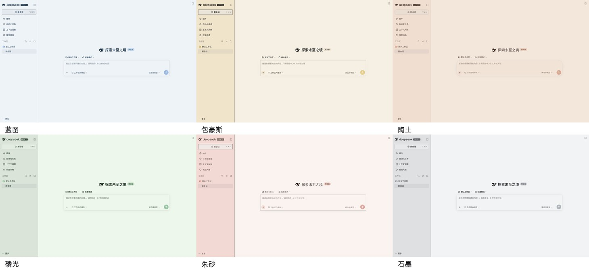
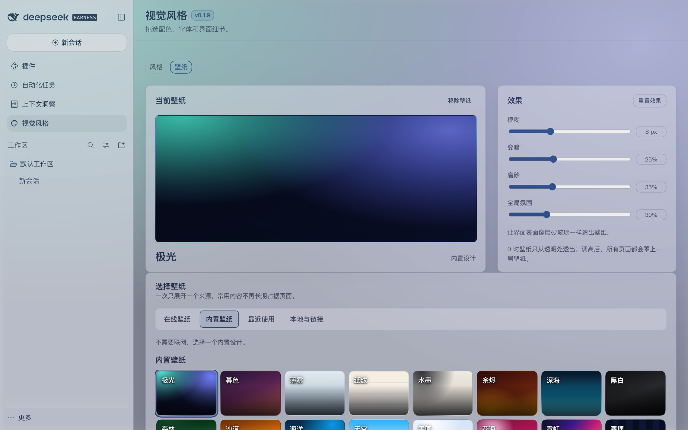
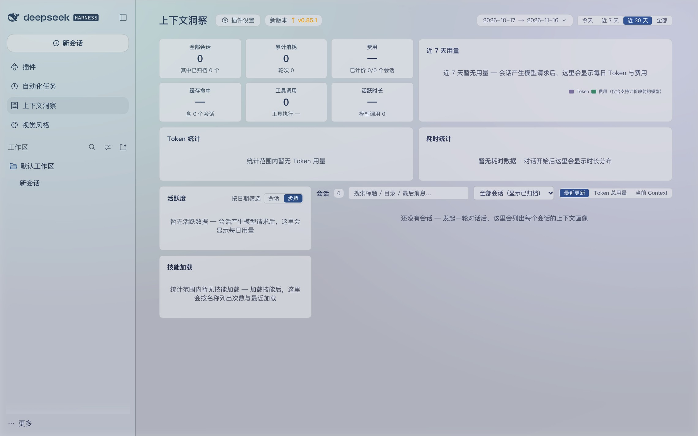

# DSH Livery (dsh-livery)

[](LICENSE)
[](https://www.npmjs.com/package/dsh-livery)
[](package.json)
[](#支持的-dsh-版本)

> **让 DSH 好看，也让 DSH 好用。**

DeepSeek Harness 的视觉层插件：**28 套精选风格**、带在线图片和虚化/磨砂效果的壁纸工作室，
以及视觉风格画廊。它以插件形式提供视觉层，**不接管宿主主题**。

> **发布状态：`0.2.0` — 视觉与协议版本。**
> 13 个声明 scope 均已有当前验收证据，发布门禁通过。当前发布制品为 `dsh-livery@0.2.0`。
> **稳定认证：** DSH `0.2.1-rc.2` + Web Profile，DSH `0.2.1-rc.3` + macOS Desktop。
> **预览：** DSH `0.2.1-rc.4` Web、DSH `0.2.1-rc.5` Web/Desktop、DSH `0.2.2-rc.1`
> Web/Desktop、DSH `0.2.2-rc.2` Web/Desktop、DSH `0.2.2-rc.3` Web/Desktop、DSH `0.2.2-rc.5` Web/Desktop。
> `0.2.2-rc.3` 是 npm `next` 且 GitHub prerelease；`0.2.2-rc.5` 是 npm
> `latest` 但仍是 GitHub prerelease，因此两者都保持预览声明。`0.2.0`
> 候选只接受 exact-certified 宿主：未知构建整体 fail closed；Windows Desktop、Edge
> 和其他 DSH 构建不在支持范围内。

[English](README.md) · 中文



截图为中文界面；英文 README 使用英文界面。Livery 跟随 DSH 宿主语言。

## 0.2.0 更新

- **中文排版真正可选。** 本地字体栈从 10 套增加到 13 套，新增 `kai-cjk`、`fangsong-cjk`、
  `rounded-cjk`。中文 UI、正文和代码可以按风格不同；包豪斯、蓝图、宣纸、樱、青瓷、
  陶土、朱砂、梅和玫瑰松使用不同中文字体。
- **可见的文字层级。** 次级/三级文字从每套风格的 text/surface seeds 派生，不再共用宿主
  的中性 ramp；标签、元数据和链接有明确明暗差，同时保持对比度审计。
- **L5a Studio Decoration 覆盖 26/28。** 网格、点阵、横线和边框由 surface 轴派生，
  只出现在 Livery 自有页面；`solid` 和 `glass` 保持素面。
- **更克制的视觉风格页。** 宽屏下实时预览与当前风格说明同排，恢复按钮不再换行。
- **更清晰的 macOS 侧栏。** 侧栏 fill 比主栏多 frost 20%（上限 94%），文字在浅色壁纸上
  可读，同时保留壁纸透视；最终 tint/wash 仍由宿主合成。
- **协议加固。** v2 presentation axes、Audit Envelope、exact-host adapter、Catalog 深验证，
  13 个 scope 全部重新验收。

## 功能亮点

- **六轴 28 套风格。** 色彩（OKLab seeds → 完整明暗 token）、字体（13 套本地字体栈，含 6 套中文字体、9 种
  排版配置）、模块形状、层级/材质、边框/焦点和组件 chrome。包含 14 套原创、12 套宽松
  许可配色和 2 套原创中式设计。
- **实时预览，而不是 Hero + 长滚动。** 当前风格在真实 DSH 表面旁展示说明；28 套风格放在
  一个连续的 6/4/3/2 列网格里，分类 chip 是唯一分类导航。
- **每张卡片都有风格 DNA。** 卡片直接标出表面配方、组件 chrome 和 UI 字体族，应用前
  就能分辨形状和组件差异。
- **GUI 优先的 palette。** 蓝图、包豪斯、陶土和磷光不是简单换色：工程青、明黄/钴蓝
  展示体、赤陶胶囊和绿色 CRT 终端表面。
- **组件 chrome。** `layout.chrome` 可从 seeds 推导并着色/描边/压暗/块状填充侧栏、
  composer、气泡、active 行和 selector；随包提供 6 个配方，28 套风格各选一个。
- **壁纸工作室。** 在线 Picsum/Openverse、24 张内置 CSS 壁纸、Recent、本地/链接上传
  （IndexedDB）。模糊 0–24 px、变暗 0–70 %、磨砂 0–100 %、全局氛围。两层壁纸均为
  viewport-relative `cover`，只裁切、不拉伸变形。
- **预设和焦点位置。** 导出/导入 风格 + 壁纸 + 效果 + 九宫格焦点；远程/上传壁纸支持
  指针和键盘焦点定位。预设不包含上传 blob、CSS、token 或本地路径。
- **macOS 侧栏清晰且独立。** 侧栏 fill 比主栏多 frost 20%（上限 94%），文字在浅色壁纸上可读，同时保留壁纸透视；最终 tint/wash 仍由宿主合成，探针测真实 DOM 表面。
- **可验证的信任边界。** 精确宿主 allowlist、冻结契约、纯 token CSS、loader ABI、
  对比度/CSS 审计和提交的验收 evidence。未知宿主安装时拒绝，运行时 fail closed 回 stock。

## 风格



28 套风格中的六套：**蓝图、包豪斯、陶土、磷光、朱砂、石墨**。每个画面都是应用该风格
后的真实 DSH 界面；画廊使用同一套预览。

## 壁纸



0.2.0 的壁纸工作室：实时 16:9 预览、L5a 点阵与四个来源页签。模糊、变暗、磨砂和全局氛围作用于整个界面；焦点位置
只对远程和上传壁纸可用，内置设计没有焦点控件。打开页签会加载一批内容；搜索、随机、
翻页或切换来源都由你主动触发。壁纸选择保存在本地。

## 所有 DSH 插件页面



这是应用同一套风格和壁纸后的上下文洞察页。轨迹、上下文、编队等宿主插件页共享 livery
token 层：卡片、表格和浮层沿用同一套 surface 层级，第三方图表调色变量映射到当前风格
token；不写任何逐插件选择器或宿主 hashed class。

## 支持的 DSH 版本

`engines.dsh` 是经过 review 的 0.2 **可安装范围**；运行时只接受 exact-certified 宿主：

```text
>=0.2.1-rc.2 <0.3.0
```

只有正式矩阵中的构建才有运行时 adapter；范围内但未认证的构建可以安装，但会在 adapter 选择前 fail closed，不做版本号 fallback。

| 宿主版本 | 入口 | 运行时 | 状态 |
|---|---|---|---|
| DSH `0.2.1-rc.2` | Web Profile + Chrome `156.0.8078.48` | Node `22.23.1` | **稳定认证**（npm `latest`） |
| DSH `0.2.1-rc.3` | macOS Desktop app | Electron `44.7.0` / Node `24.21.0` / Chromium `152.0.7977.130` | **稳定认证**渲染器表面 |
| DSH `0.2.1-rc.4` | Web Profile + Chrome `156.0.8078.48` | Node `22.23.1` | **next 预览** |
| DSH `0.2.1-rc.5` | Web + macOS Desktop | Node `22.23.1` / `24.21.0` | **预览** |
| DSH `0.2.2-rc.1` | Web + macOS Desktop | Node `22.23.1` / `24.21.0` | **预览** |
| DSH `0.2.2-rc.2` | Web + macOS Desktop | Node `22.23.1` / `24.21.0` | **预览**（npm `next`） |
| DSH `0.2.2-rc.3` | Web + macOS Desktop | Chrome `156.0.8078.48` / Electron `44.7.0` / Node `24.21.0` / Chromium `152.0.7977.130` | **预览**（npm `next`） |
| DSH `0.2.2-rc.5` | Web + macOS Desktop | Chrome `156.0.8078.48` / Electron `44.7.0` / Node `22.23.1` / `24.21.0` / Chromium `152.0.7977.130` | **预览**（npm `latest`，GitHub prerelease） |

exact-only 不是安装范围承诺；未知构建仍会 fail closed。稳定支持
要求官方 GitHub 非 prerelease 发布和 npm `latest` 上匹配的签名包；npm `next` 和 GitHub
prerelease 属于预览声明，不承诺渠道稳定性。macOS 原生窗口 chrome、红绿灯、vibrancy、
Dock/rightbar 和系统级 DPI 由宿主负责，不在插件认证范围内。完整策略见
[docs/design/multi-version.md](docs/design/multi-version.md)。

## 安装

npm 最新发布版：[`dsh-livery@0.2.0`](https://www.npmjs.com/package/dsh-livery)。

### Web Profile

```bash
dsh plugin --profile web add dsh-livery@0.2.0
dsh web
```

### Desktop app

```bash
dsh plugin --profile desktop add dsh-livery@0.2.0
```

包变化后重启 App。也可以在 **设置 → 插件** 中按包名安装。

如果新版本被 registry age window 拒绝：安装精确 release tarball，并先核对公布的
sha256。不要安装未校验的 tarball。

## 验收

`0.2.0` 制品已在 13 个 Web/Desktop scope 上完成隔离全量验收：
Web `0.2.1-rc.2`、`0.2.1-rc.4`、`0.2.1-rc.5`、`0.2.2-rc.1`、`0.2.2-rc.2`、`0.2.2-rc.3`、`0.2.2-rc.5`
（各 275 通过 / 0 失败）与 Desktop `0.2.1-rc.3`、`0.2.1-rc.5`、`0.2.2-rc.1`、`0.2.2-rc.2`、`0.2.2-rc.3`、`0.2.2-rc.5`
（各 34 通过 / 0 失败）。证据绑定在 `contracts/dsh/evidence/0.2.0/`。
范围、计数和已知限制见 [docs/verification.md](docs/verification.md)。

发布门禁包括 `tsc`、完整测试、token/对比度/CSS 审计、loader ABI、支持矩阵/release
门禁、`release:prepare` 和 `prepublish-check`。发布 workflow 不重新构建已验收 tarball。

## 文档

- [文档索引](docs/README.md)
- 设计：[接口](docs/design/interfaces.md) · [样式系统](docs/design/style-system.md) · [壁纸工作台](docs/design/wallpaper-workbench.md) · [多版本策略](docs/design/multi-version.md)
- [验收摘要](docs/verification.md)
- [CHANGELOG](CHANGELOG.md) · [SECURITY](SECURITY.md) · [SUPPORT](SUPPORT.md)

## 许可

MIT，见 [LICENSE](LICENSE)。配色来源见 [NOTICE.md](NOTICE.md)。预览缩略图和内置壁纸都由
插件自己的数据生成；可选的壁纸工作室只在你打开壁纸标签页或主动操作时才加载在线图片
（见 [SECURITY.md](SECURITY.md)）。
