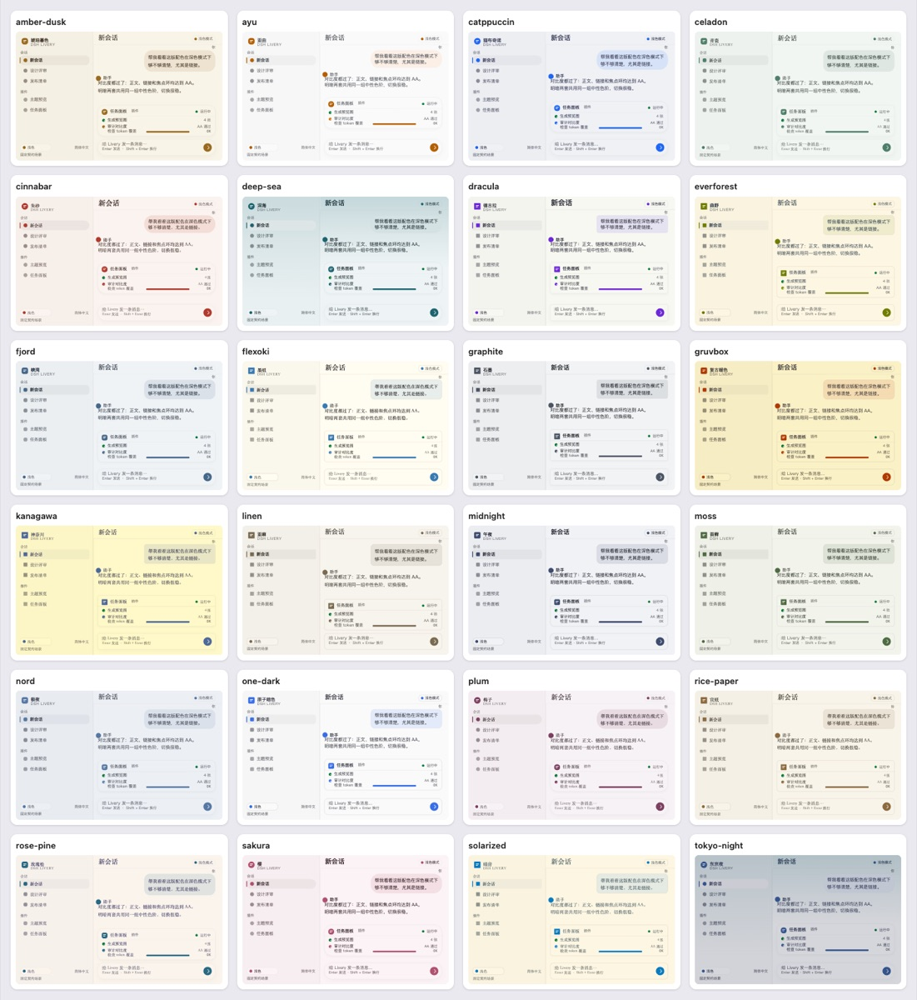
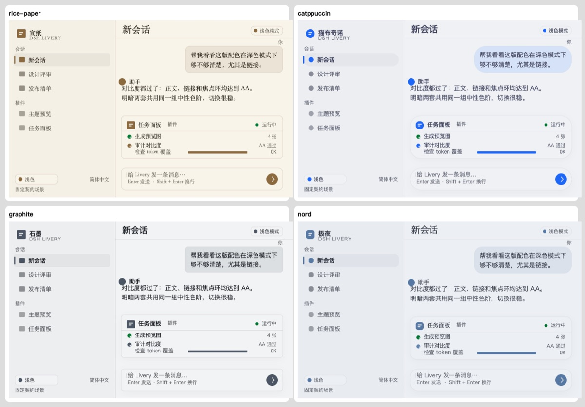
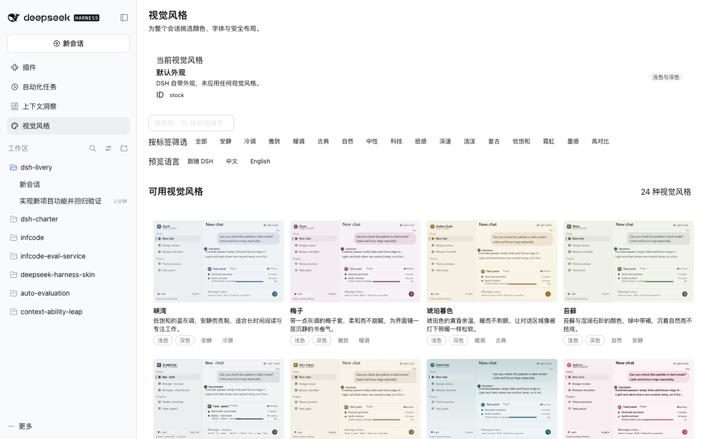
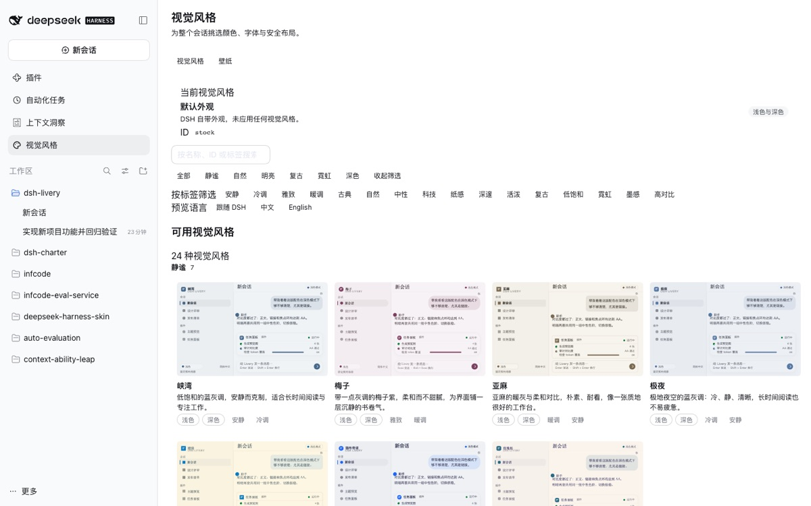

# DSH Livery

[](LICENSE)
[](package.json)
[](#支持的宿主版本)

**为 [DeepSeek Harness](https://github.com/deepseek-ai/deepseek-harness) 提供 24 套内置视觉风格。**
DSH Livery 只做「风格」：配色、字体、模块造型、层次与材质——以契约约束的插件形式实现，
不接管宿主主题、不注册主题、不绘制窗口 chrome。

[English](README.md) · [中文](README.zh-CN.md)



## 为什么是 DSH Livery

很多皮肤插件会接管宿主主题、注册自己的主题 id、绘制窗口 chrome 或注入大范围 CSS。
DSH Livery 刻意收窄了边界：

- **契约约束。** 只支持精确宿主版本（`0.2.0-rc.2`、`0.2.1-rc.2`、`0.2.1-rc.3`），
  六类冻结契约哈希 + 汇总哈希；未知宿主 fail-closed 回退原生外观，不做猜测。
- **纯 token 渲染。** 每套风格只输出一组 light/dark 语义 token 用于首帧，客户端命中时
  零 CSS 文本写入；不注册主题、不调用 `setTheme`、不写 `data-ds-*`、不画窗口 chrome。
- **一级入口。** 主页面左侧栏「视觉风格」插件面板，与插件/自动化任务/上下文洞察同级，
  不再藏在设置页。
- **预览语言 tab。** 缩略图可「跟随 DSH」或固定为 中文 / English，方便在不切换应用语言
  的情况下检查两种语言的字体风格；应用后的风格始终按宿主语言匹配字体。
- **诚实降级。** 宿主不存在的能力（如结构性布局 hook）在自检中如实展示，不伪造。

## 风格

24 套风格在五个维度上产生差异：

| 维度 | 变化内容 |
|---|---|
| 配色 | 每模式 4 个 OKLab 种子 → 完整语义 token，逐项过对比度（每 profile 2,832 条断言，0 失败） |
| 字体 | 10 个纯本地字体栈（系统/人文/宋体/显示体/圆体/等宽）+ 9 个排版尺度 |
| 模块造型 | `--dsw-radius-*`、`--dsw-corner-shape`，从 2–6px 锐角到 16–32px 圆角 |
| 层次/材质 | 9 种表面配方：纸感/扁平发丝描边、高浮起阴影、玻璃 `backdrop-filter` |
| 边框 | 边框色、focus ring、强调用的细线处理 |

10 套为原创；12 套受宽松许可的开源配色启发（Nord、Dracula、Gruvbox、Solarized、
Catppuccin、Tokyo Night、Rosé Pine、Everforest、Kanagawa、One Dark、Ayu、Flexoki，
许可与归属见 [NOTICE.md](NOTICE.md)）；另有 2 套中式原创（青瓷、朱砂）。所有配色都重新
推导进 DSH 的 token 体系，不是像素级复刻。



## 安装

### Web Profile（CLI）

```bash
pnpm build && pnpm pack                 # 或使用已发布的 dsh-livery-*.tgz
dsh plugin --profile web add ./dsh-livery-0.4.0.tgz
dsh web                                 # 打开命令输出的地址
```

### Desktop Profile（0.2.1-rc.3）

通过 DeepSeek Harness Desktop 应用的插件管理器安装。应用运行时会在安装时强制校验
`engines.dsh`；本包声明 `0.2.0-rc.2 || 0.2.1-rc.2 || 0.2.1-rc.3`。

## 使用

打开左侧栏，在「工作区」上方点击 **视觉风格**（英文界面为 **Visual Style**）。
预览是临时的；「应用」只写入一次配置；「恢复默认外观」可移除。选中后整个应用的配色、
字体与模块设计随之变化。画廊工具栏的「预览语言」可在 跟随 DSH / 中文 / English 之间切换
（仅预览图；应用后按 DSH 语言匹配字体）。





## 支持的宿主版本

| DSH 版本 | Adapter | 状态 |
|---|---|---|
| `0.2.0-rc.2` | `dsh-0.2.0-rc.2-r1` | Web/Chrome 已认证；Desktop 待验证 |
| `0.2.1-rc.2` | `dsh-0.2.1-rc.2-r1` | Web/Chrome 已认证；Edge/Desktop 待验证 |
| `0.2.1-rc.3` | `dsh-0.2.1-rc.3-r1` | Desktop packaged runtime + 真实 Electron 渲染器已验证；原生窗口 chrome 待验证 |

验收矩阵见 [docs/verification.md](docs/verification.md)，机器可读状态见
[contracts/dsh/support-matrix.proposed.json](contracts/dsh/support-matrix.proposed.json)，
多版本设计见 [docs/design/multi-version.md](docs/design/multi-version.md)。

## 仓库结构

| 路径 | 内容 |
|---|---|
| `src/core` | 颜色推导、对比度、token 渲染、注册表、风格审计 |
| `src/compiler` | manifest 校验、预览、审计、编译器 CLI |
| `src/host` | Cordis 宿主插件：门禁、首帧注入、catalog/预览路由 |
| `src/client` | 浏览器插件：握手、运行时、设置 UI、侧栏面板 |
| `src/contract` | 契约快照/diff、adapter 生成、支持矩阵门禁 |
| `src/generated` | 已提交的生成物：契约、stock token 快照、编译后的 catalog |
| `liveries/` | 24 套内置风格 manifest（schema：`schemas/livery.schema.json`） |
| `contracts/` | 冻结的宿主契约快照与支持矩阵 |
| `scripts/` | 构建/CLI 工具与浏览器验收 harness |
| `tests/` | 单元、编译器、宿主、客户端、契约与浏览器 harness 测试 |
| `docs/` | 设计文档、研究笔记与验收总结 |

## 开发

要求：Node `^22.23.1 || ^24.21.0`，pnpm 12。

```bash
pnpm install
pnpm verify          # typecheck + 测试 + 生成物检查 + 审计 + 构建 + 打包检查
pnpm lint
pnpm test:loader-abi
pnpm adapter:check
```

契约快照、stock token 与编译后的 catalog 已提交，因此没有本地 DSH 安装也能 `pnpm build`。
重新生成宿主契约需要对应 DSH 版本，见 [docs/design/multi-version.md](docs/design/multi-version.md)。

浏览器验收（需要本地 DSH、系统 Chrome 与已打包的 tarball）：

```bash
node scripts/acceptance/web.mjs --tgz ./dsh-livery-0.4.0.tgz
node tests/browser/run.mjs --tgz ./dsh-livery-0.4.0.tgz      # 薄封装
```

## 参与贡献

- [贡献指南](CONTRIBUTING.zh-CN.md) · [Contributing](CONTRIBUTING.md)
- [行为准则](CODE_OF_CONDUCT.md)
- [安全策略](SECURITY.md)
- [支持](SUPPORT.md)

提交保持一句话简洁（`feat:`、`fix:`、`docs:`、`test:`、`chore:`）。

## 文档

- [文档索引](docs/README.md)
- 设计：[接口](docs/design/interfaces.md) · [风格系统](docs/design/style-system.md) · [多版本](docs/design/multi-version.md) · [实现计划](docs/design/implementation-plan.md)
- 研究：[宿主契约](docs/research/host-contract.md) · [客户端契约](docs/research/client-contract.md) · [设计参考](docs/research/design-references.md)
- [验收总结](docs/verification.md)

## 许可证

MIT，见 [LICENSE](LICENSE)。配色归属见 [NOTICE.md](NOTICE.md)。所有预览图与截图均由
插件自身 token 数据生成；不捆绑任何第三方图片或字体。
