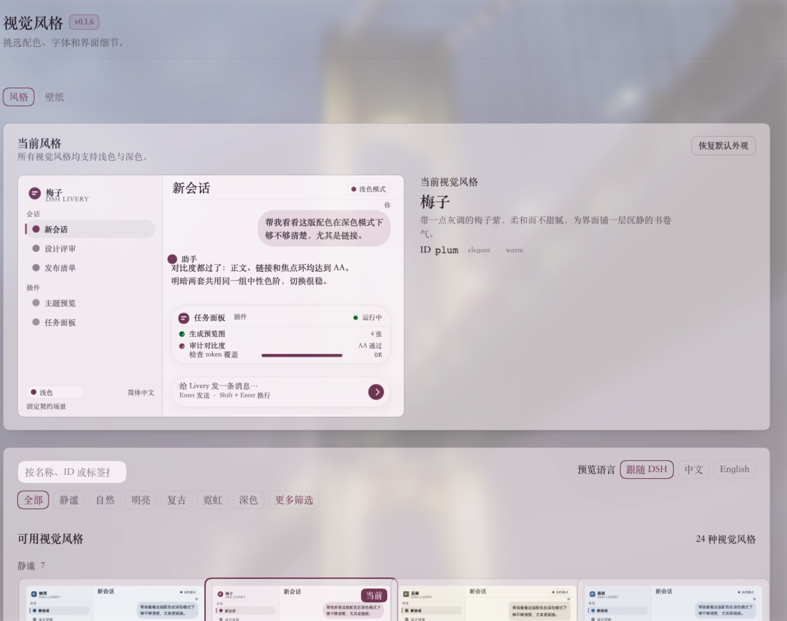
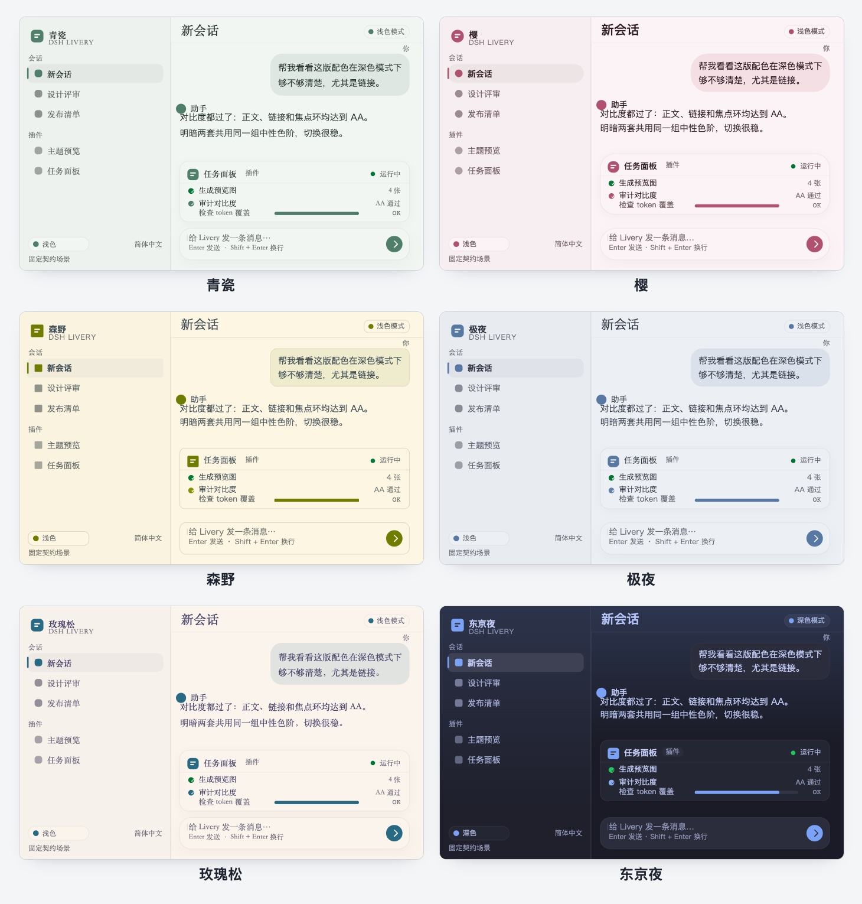
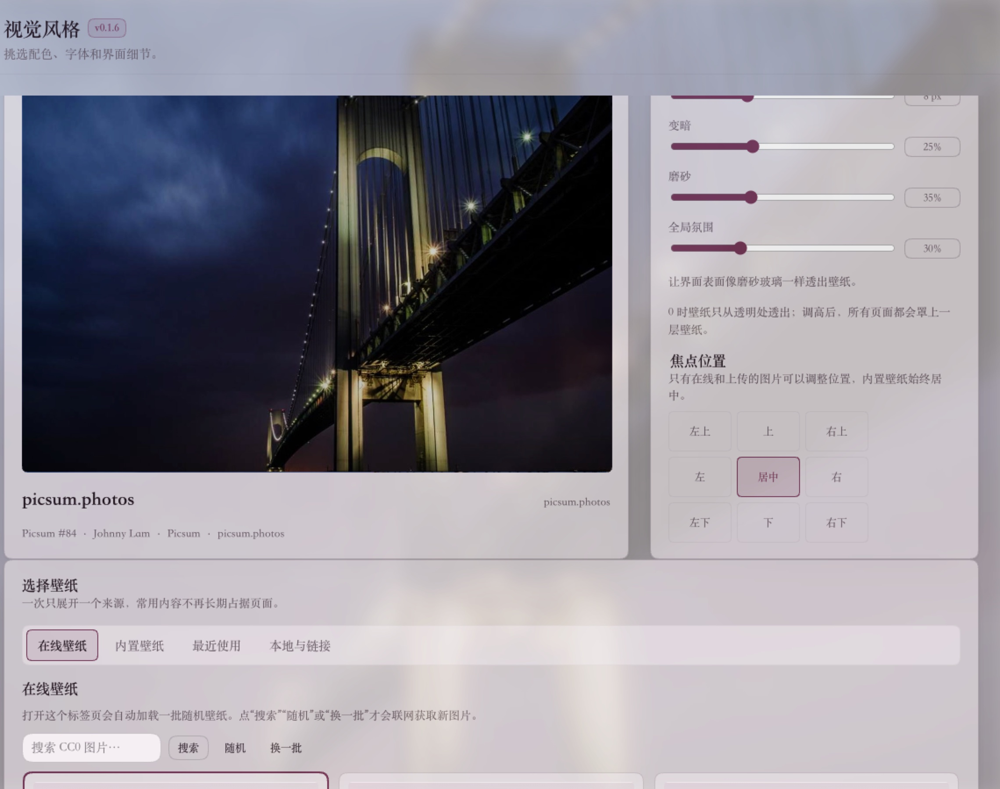
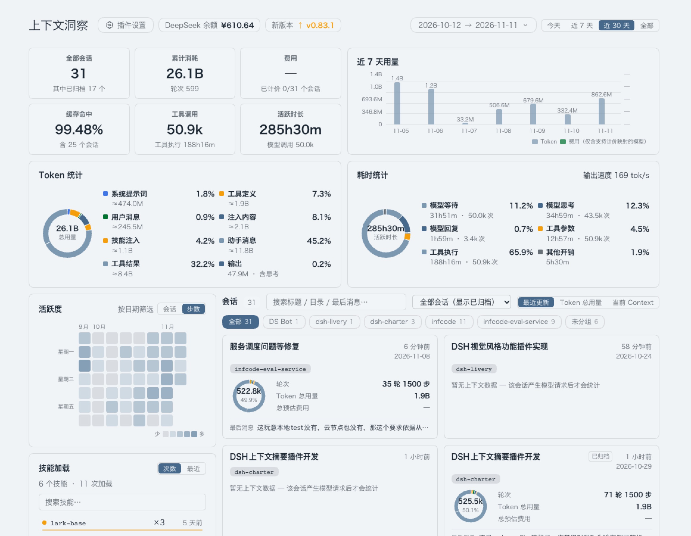

# DSH Livery (dsh-livery)

[](LICENSE)
[](https://www.npmjs.com/package/dsh-livery)
[](package.json)
[](#支持的-dsh-版本)

> **让 DSH 好看，也让 DSH 好用。**

DeepSeek Harness 的视觉层插件：**24 套精选风格**、带在线图片和虚化/磨砂效果的壁纸工作室，
以及视觉风格画廊。它以插件形式提供视觉层，**不接管宿主主题**。

> **发布状态：0.1.8 发布候选。** `0.1.7` 是当前 npm 发布版；`0.1.8` 将精确版本加载
> 改为 API hash 兼容 + 经 review 的共享 catalog profile，DSH Desktop `0.2.2-rc.2`
> 这类 0.2.x 兼容更新不再需要新增完整 profile。
>
> **稳定认证：** DSH `0.2.1-rc.2` + Web Profile，DSH `0.2.1-rc.3` + macOS Desktop。
> **预览：** DSH `0.2.1-rc.4` Web、DSH `0.2.1-rc.5` Web/Desktop、DSH `0.2.2-rc.1`
> Web/Desktop。`0.2.2-rc.1` 现在是 npm `latest`，但 GitHub release 仍是 prerelease，因此仍是预览声明。Windows Desktop、Edge 和其他 DSH 构建不在支持范围内，并会 fail closed。

[English](README.md) · 中文



截图为中文界面；Livery 跟随 DSH 宿主语言。样式展示使用真实在线 Picsum 壁纸，而不是内置默认壁纸。

## 0.1.8 更新

- **兼容架构。** 准入由 loader/host/client API hash 决定，而不是只看精确版本串。
  `engines.dsh` 改为 `>=0.2.1-rc.2 <0.3.0`；同 0.2 系列新版本可使用最新 certified
  adapter 的 compatible-preview 模式，并输出诊断警告；跨系列或 API 不兼容版本仍 fail closed。
- **共享 catalog profile。** 新增经 review 的
  `contracts/dsh/catalog-profile-overrides.json`；token 契约兼容的版本复用 certified
  profile。DSH `0.2.2-rc.2` 复用 rc.1 profile，host bundle 不再为每个 rc 增加整套 catalog。
- **热更新跟随，无需退出 App。** DSH HMR 替换 client 模块后，新版本不再拒绝旧版本的
  boot payload；会重新拉取 live catalog、在 recomposition 窗口内重试，并恢复已保存皮肤。
  冷启动仍是验收基准。
- **DSH `0.2.2-rc.2` 适配。** 冻结契约、npm `next` / preview 声明，并完成真实 Electron
  Desktop 验收。详见 [兼容架构](docs/design/compatibility.md)。

## 0.1.7 更新

- **在线结果缩略图恢复。** Online 页签现在会渲染图源缩略图；加载中显示本地骨架，失败时
  保留骨架作为回退。此前只渲染骨架，列表正常时看起来也是空白，直到点击后才生效。
- **继承 0.1.6：** DSH `0.2.2-rc.1` Web/Desktop 支持、1440 等高工作台、1024/767 单列布局、
  `v0.1.7` 标题标识，以及在线壁纸优先的视觉/README 验收。
- **DSH 插件页面统一 surface。** 轨迹、上下文、编队等宿主插件页继承同一套 livery 层级和
  调色变量；第三方数据视图使用当前风格强调色，而不是固定 stock 图表色。
- **文档纪律。** 重要设计变更随版本写入 `docs/design/`；README、SECURITY、支持矩阵和
  CHANGELOG 作为同一发布集同步更新。

## 功能

- **五轴 24 套风格。** 色彩（OKLab seeds → 完整明暗 token）、字体（10 套本地字体栈、9 种
  排版配置）、模块形状、层级/材质、边框/焦点。包含 10 套原创、12 套宽松许可配色和
  2 套原创中式设计。
- **壁纸工作室。** 在线 Picsum/Openverse、24 张内置 CSS 壁纸、Recent、本地/链接上传
  （IndexedDB）。模糊 0–24 px、变暗 0–70 %、磨砂 0–100 %、全局氛围。两层壁纸均为
  viewport-relative `cover`，只裁切、不拉伸变形。
- **预设和焦点位置。** 导出/导入 风格 + 壁纸 + 效果 + 九宫格焦点；远程/上传壁纸支持
  指针和键盘焦点定位。预设不包含上传 blob、CSS、token 或本地路径。
- **工作台 UI。** 风格页包含当前风格 Hero 和全宽画廊；壁纸页包含当前壁纸、效果和
  四页签来源卡；预设与本地数据清理收在可折叠管理区。
- **可验证的信任边界。** 精确宿主 allowlist、冻结契约、纯 token CSS、loader ABI、
  对比度/CSS 审计和提交的验收 evidence。未知宿主安装时拒绝，运行时 fail closed 回 stock。

## 风格



24 套风格中的六套：**青瓷、梅子、Everforest、Nord、Rosé Pine、Tokyo Night**。这些是
随包发布的固定预览场景，实时画廊使用同一套预览。

## 壁纸



从“在线壁纸”加载的真实 Picsum 图片，包含焦点位置和四个来源页签。打开页签会加载一批
随机图片；搜索、随机、翻页或切换来源都由你主动触发。壁纸选择保存在本地。

## 所有 DSH 插件页面



轨迹、上下文、编队和内置工作室共用同一套实现：livery 层级让卡片/表格/浮层在页面底色上
保持可见层级，第三方图表调色变量映射到当前风格 token；不写任何逐插件选择器或宿主 hashed class。

## 支持的 DSH 版本

`engines.dsh` 精确 allowlist：

```text
0.2.1-rc.2 || 0.2.1-rc.3 || 0.2.1-rc.4 || 0.2.1-rc.5 || 0.2.2-rc.1
```

| 宿主版本 | 入口 | 运行时 | 状态 |
|---|---|---|---|
| DSH `0.2.1-rc.2` | Web Profile + Chrome `156.0.8078.48` | Node `22.23.1` | **稳定认证**（npm `latest`） |
| DSH `0.2.1-rc.3` | macOS Desktop app | Electron `44.7.0` / Node `24.21.0` / Chromium `152.0.7977.130` | **稳定认证**渲染器表面 |
| DSH `0.2.1-rc.4` | Web Profile + Chrome `156.0.8078.48` | Node `22.23.1` | **next 预览** |
| DSH `0.2.1-rc.5` | Web + macOS Desktop | Node `22.23.1` / `24.21.0` | **预览** |
| DSH `0.2.2-rc.1` | Web + macOS Desktop | Node `24.22.1` / `24.21.0` | **预览** |
| DSH `0.2.2-rc.2` | Web + macOS Desktop | Node `24.22.1` / `24.21.0` | **预览**（npm `next`） |

没有兼容模式。不同 DSH 版本会在安装时拒绝，运行时 fail closed 回 stock。稳定支持要求
官方 GitHub 非 prerelease 发布和 npm `latest` 上匹配的签名包；npm `next` 和 GitHub
prerelease 属于预览声明，不承诺渠道稳定性。macOS 原生窗口 chrome、红绿灯、vibrancy、
Dock/rightbar 和系统级 DPI 由宿主负责，不在插件认证范围内。完整策略见
[docs/design/multi-version.md](docs/design/multi-version.md)。

## 安装

npm 最新发布版：[`dsh-livery@0.1.7`](https://www.npmjs.com/package/dsh-livery)。

### Web Profile

```bash
dsh plugin --profile web add dsh-livery@0.1.7
dsh web
```

### Desktop app

打开 **设置 → 插件 → 按包名安装**，输入 `dsh-livery@0.1.7`；或使用 app 自带 CLI：

```bash
"/Applications/DeepSeek Harness.app/Contents/Resources/runtime/cli/bin/dsh" \
  plugin --profile desktop add dsh-livery@0.1.7
```

如果新版本被 registry age window 拒绝：下载精确 tarball，核对 release sha256 后用本地
文件安装。不要安装未校验的 tarball。

## 验收

正式发布制品已通过 Web `0.2.1-rc.2`、`0.2.1-rc.4`、`0.2.1-rc.5`、`0.2.2-rc.1`
（各 275 通过 / 0 失败）与 Desktop `0.2.1-rc.3`、`0.2.1-rc.5`、`0.2.2-rc.1`
（各 34 通过 / 0 失败）的隔离全量验收。0.1.7 evidence
位于 `contracts/dsh/evidence/0.1.7/`，范围、计数和已知
限制见 [docs/verification.md](docs/verification.md)。

发布门禁包括 `tsc`、完整测试、token/对比度/CSS 审计、loader ABI、支持矩阵/release
门禁、`release:prepare` 和 `prepublish-check`。发布 workflow 不重新构建已验收 tarball。

## 文档

- [文档索引](docs/README.md)
- 设计：[接口](docs/design/interfaces.md) · [样式系统](docs/design/style-system.md) · [壁纸工作台](docs/design/wallpaper-workbench.md) · [多版本策略](docs/design/multi-version.md)
- [验收摘要](docs/verification.md)
- [CHANGELOG](CHANGELOG.md) · [SECURITY](SECURITY.md) · [SUPPORT](SUPPORT.md)

## 许可

MIT，见 [LICENSE](LICENSE)。配色来源见 [NOTICE.md](NOTICE.md)。预览缩略图和内置壁纸都由
插件自己的数据生成；可选的壁纸工作室只在你打开壁纸标签页或主动操作时才加载在线图片
（见 [SECURITY.md](SECURITY.md)）。
