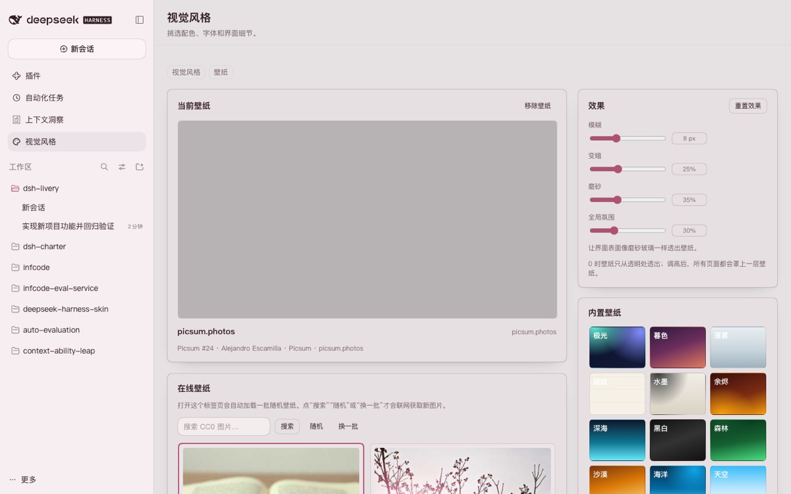
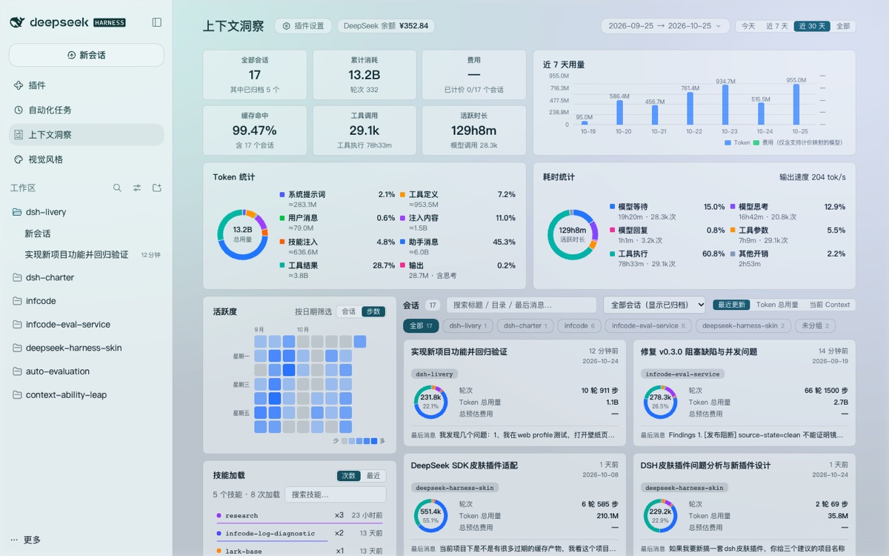

# DSH Livery（dsh-livery）

[](LICENSE)
[](package.json)
[](#宿主支持与版本策略)

**DeepSeek Harness 的视觉风格插件**：24 套受契约约束的风格、带在线图片搜索和虚化/磨砂效果的壁纸工作室，
以及按风格分组的画廊。它以插件形式提供视觉层，**不接管宿主主题**。

> **发布状态：0.1.0 有限发布。** 仅支持：DSH `0.2.1-rc.2` + Web Profile + Chrome，
> 以及 DSH `0.2.1-rc.3` Desktop（macOS）。Desktop Windows、Web Edge 和其他 DSH 版本均不支持，
> 会被直接拒绝。发布产物必须与已提交的 evidence 文件绑定；`prepublish-check` 会拒绝不匹配的字节。

[English](README.md) · [中文](README.zh-CN.md)


## 为什么不是“又一个皮肤”

普通皮肤插件常常接管宿主主题、注册自己的主题 id、绘制窗口装饰、注入大范围 CSS，这些做法也正是
DSH 更新后容易失效的原因。DSH Livery 选择了相反的取舍：

| 普通皮肤插件 | DSH Livery |
|---|---|
| 接管 `ctx.theme`、注册主题、调用 `setTheme` | 每套风格只输出一组作用域内的语义 token；从不注册或拥有宿主主题 |
| 绘制窗口装饰（标题栏、浮层） | 不绘制窗口装饰，窗口归宿主所有 |
| 大量基于选择器的 CSS，宿主一重构就失效 | 纯 token 渲染 + body 作用域壁纸层；不使用宿主组件选择器 |
| DSH 一更新就失效或只工作一半 | 正式限定范围：精确宿主版本 + Web + Chrome；其他宿主直接拒绝，不做猜测 |
| “相信我”的主题 | 冻结的契约哈希、loader-ABI 检查、对比度/CSS 审计和公开的验收矩阵 |

区别是：这是一套可以检查的视觉系统，不是一份样式表。它包含 24 套五维设计、壁纸工作室、风格画廊，
以及能跟上 DSH 更新的版本策略。

## 功能

- **24 套风格、五个维度。** 配色（OKLab 种子 → 完整明暗 token）、字体（10 个纯本地字体栈 + 9 套排版参数）、
  模块造型（`--dsw-radius-*`、`--dsw-corner-shape`）、层次与材质（纸张或扁平细线面板、悬浮卡片、玻璃
  虚化）、边框与焦点样式。包含 10 套原创设计、12 套受开源配色启发（MIT/Apache-2.0，见 [NOTICE](NOTICE.md)）
  和 2 套中式原创（青瓷、朱砂）。
- **壁纸工作室。** 24 套内置 CSS 壁纸，另有**在线壁纸**卡片：打开壁纸标签页时会自动加载一批随机
  Picsum 壁纸，之后可以搜索 Openverse（CC0/PDM）、随机或换一批；也支持本地上传（保存在 IndexedDB）和
  https 图片 URL。效果包括虚化 0–24 px、暗化 0–70%、磨砂 0–100%，以及全局氛围层，让壁纸在所有
  插件页面（包括第三方不透明面板）都可见。两层都按窗口大小使用 `cover`，竖屏、超宽屏或缩放窗口
  只裁切，不拉伸。联网由打开标签页或主动操作触发，选择保存在本地。
- **卡片式工作室布局，统一字号尺度。** 两个页面都用响应式卡片模块，而不是平铺列表。壁纸页包含
  壁纸预览、搜索优先的在线壁纸卡片、自定义上传/URL 卡片，侧栏是紧凑的 140 px 效果滑杆和 24 套
  内置壁纸网格；风格页由当前风格卡片（含预览缩略图）、画廊卡片和“操作 / 自检”侧栏组成。全站
  共用一套五级字号尺度，窄窗口下卡片自动堆叠。
- **风格画廊。** 风格按六个分组排列（静谧 / 自然 / 明亮 / 复古 / 霓虹 / 深色），主筛选排在前面，
  完整标签收在“更多筛选”里；预览语言标签页可在跟随 DSH / 中文 / English 之间切换缩略图。
- **侧栏入口。** 左侧栏插件面板（**视觉风格**，含第二个标签页 **壁纸**），与插件 / 自动化任务 /
  上下文洞察同级。
- **有缺失就说明。** 宿主缺少的能力和未认证模式都会显示在自检里，不会假装支持。





## 宿主支持与版本策略

`engines.dsh` 是精确允许列表 **`0.2.1-rc.2 || 0.2.1-rc.3`**。这一发布线的支持范围刻意收窄：

| 范围 | 取值 |
|---|---|
| DSH `0.2.1-rc.2` | Web Profile + Chrome（client target Chrome 120+，实测 Chrome 155） |
| DSH `0.2.1-rc.3` | Desktop 应用，macOS（真实 Electron 渲染器） |
| 其他 | 不安装、不支持；运行时回退 stock |

没有兼容模式。其他宿主版本会在安装时被拒绝，运行时不匹配的 payload/preview 也会被拒绝。可被机器检查的正式
范围见 `contracts/dsh/support-matrix.json`（仓库内），证据见
[docs/verification.md](docs/verification.md)。


## 安装

### Web Profile（CLI）

```bash
pnpm build && pnpm pack                 # 候选构建，尚未发布
dsh plugin --profile web add ./dsh-livery-0.1.0.tgz
dsh web                                 # 打开命令输出的地址
```

### Desktop Profile（0.2.1-rc.3，macOS）

通过 DeepSeek Harness Desktop 应用的插件管理器安装；应用运行时会强制校验 `engines.dsh`。本版本只支持 macOS Desktop；应用视觉风格前请先停用其他皮肤/主题插件。

## 卸载

通过 DSH 插件管理器卸载。DSH 会保留插件在 profile 中的 `livery` 配置行；重新安装时可能沿用上次应用的
视觉风格。若不想继承，请在卸载前点击「恢复默认外观」，或从 profile 配置中移除 `livery` 行。

## 使用

打开左侧栏，在“工作区”上方点击 **视觉风格**。页面有两个标签页：

- **视觉风格**：预览（临时生效）、应用（只写入一次配置）、恢复默认外观；风格分组、搜索、
  “更多筛选”和预览语言标签页。
- **壁纸**：打开标签页会自动加载一批随机在线壁纸；也可以搜索 Openverse、随机或换一批，选择
  24 套内置壁纸之一、上传本地图片或粘贴 https URL，再调节虚化、暗化、磨砂和全局氛围。壁纸选择
  保存在浏览器本地，重启后仍然有效；全局氛围让壁纸在第三方插件页面也可见。

风格和壁纸相互独立：切换风格不会丢掉壁纸。


## 仓库结构

| 路径 | 内容 |
|---|---|
| `src/core` | 颜色推导、对比度、token 渲染、注册表、风格审计、兼容版本范围 |
| `src/compiler` | Manifest 校验、预览、审计、编译器 CLI |
| `src/host` | Cordis 宿主插件：认证/兼容门禁、首帧注入、catalog/预览路由 |
| `src/client` | 浏览器插件：握手、运行时、风格画廊、壁纸工作室、设置 UI |
| `src/contract` | 契约快照/diff、adapter 生成、支持矩阵门禁 |
| `src/generated` | 已提交的生成物：契约、stock token 快照、编译后的 catalog |
| `liveries/` | 24 套内置风格 manifest（`schemas/livery.schema.json`） |
| `contracts/` | 冻结的宿主契约快照与支持矩阵 |
| `scripts/` | 构建/CLI 工具与浏览器验收 harness |
| `tests/` | 单元、编译器、宿主、客户端、契约与浏览器 harness 测试 |
| `docs/` | 设计文档、研究笔记与验收总结 |

## 开发

要求：Node `^22.23.1 || ^24.21.0`，pnpm 12。

```bash
pnpm install
pnpm verify          # typecheck + 测试 + 生成物检查 + 审计 + 构建 + 打包检查
pnpm lint
pnpm test:loader-abi
pnpm adapter:check
```

契约、stock token 快照与编译后的 catalog 已提交，因此没有本地 DSH 安装也能运行 `pnpm build`。
浏览器验收需要本地 DSH、系统 Chrome 与已打包的 tarball：

```bash
node scripts/acceptance/web.mjs --tgz ./dsh-livery-0.1.0.tgz
node tests/browser/run.mjs --tgz ./dsh-livery-0.1.0.tgz      # 轻量封装
```

## 验收

有限发布证据（0.1.0）：Web `0.2.1-rc.2` 的隔离全量运行与真实 profile 克隆；Desktop
`0.2.1-rc.3` 的打包 Web 载体与真实 Electron 渲染器。仓库检查包括 `tsc`、680+ 项测试、
对比度/token/CSS 审计、loader ABI 与打包检查。原始证据在本地 `artifacts/` 生成，不提交。
细节与已知限制见 [docs/verification.md](docs/verification.md)。

## 参与贡献

- [贡献指南](CONTRIBUTING.zh-CN.md) · [Contributing](CONTRIBUTING.md)
- [行为准则](CODE_OF_CONDUCT.md) · [安全策略](SECURITY.md) · [支持](SUPPORT.md)

提交信息保持一行（`feat:`、`fix:`、`docs:`、`test:`、`chore:`）。

## 文档

- [文档索引](docs/README.md)
- 设计：[接口](docs/design/interfaces.md) · [风格系统](docs/design/style-system.md) · [多版本与兼容](docs/design/multi-version.md) · [视觉系统 v2](docs/design/visual-system-v2.md) · [实现计划](docs/design/implementation-plan.md)
- 研究：[宿主契约](docs/research/host-contract.md) · [客户端契约](docs/research/client-contract.md) · [设计参考](docs/research/design-references.md)
- [验收总结](docs/verification.md)

## 许可证

MIT，见 [LICENSE](LICENSE)。配色归属见 [NOTICE.md](NOTICE.md)。预览图与内置壁纸都由插件自身数据
生成，不捆绑第三方图片或字体。可选的壁纸工作室只会在打开壁纸标签页或你主动操作时加载第三方图片
（见 [SECURITY.md](SECURITY.md)）。
