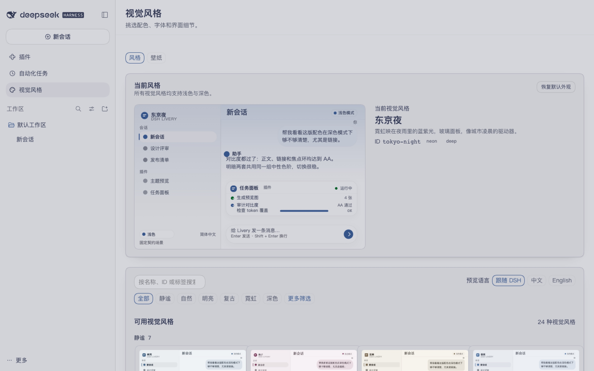
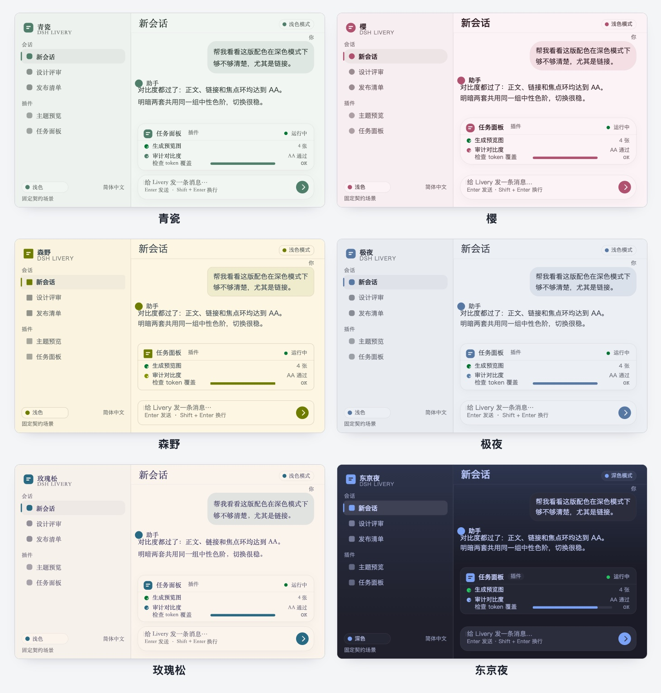
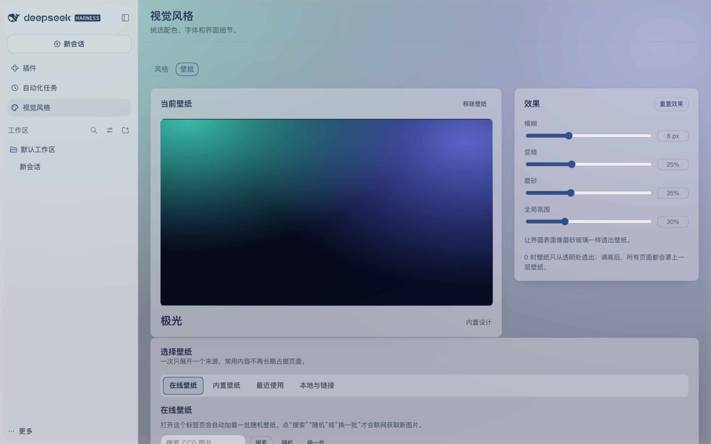

# DSH Livery（dsh-livery）

[](LICENSE)
[](https://www.npmjs.com/package/dsh-livery)
[](package.json)
[](#宿主支持与版本策略)

> **让你的 DSH 更赏心悦目，让每次使用都焕发生机。**

**DeepSeek Harness 的视觉层插件**：24 套精选风格、带在线搜索和虚化/磨砂效果的壁纸工作室，
以及视觉风格画廊。它以插件形式提供视觉层，**不接管宿主主题**。

> **发布状态：0.1.4 有限发布。**
>
> **稳定认证：** DSH `0.2.1-rc.2` + Web Profile + Chrome 156.0.8078.48 + Node 22.23.1，以及
> DSH `0.2.1-rc.3` + macOS Desktop 应用及其 Electron/Node 24 运行时。
>
> **next 通道预览：** DSH `0.2.1-rc.4` + Web Profile + Chrome 156.0.8078.48 + Node 22.23.1。
> 官方 npm 包已签名，精确 tarball 已纳入验收 evidence；但上游尚未发布对应的 GitHub
> tag/release，因此这是兼容性预览，不是对预发布通道的稳定性承诺。
>
> Desktop Windows、Web Edge 和其他 DSH 版本不在支持范围内；其他 DSH 版本会在安装/运行时
> 被拒绝并回退 stock。发布产物必须与已提交的验收 evidence 绑定；`prepublish-check` 会拒绝
> 不匹配的字节。

[English](README.md) · 中文



所有截图都来自真实 Web Profile（截图显示中文界面；插件会跟随 DSH 宿主语言）。风格合集使用随包发布的
固定预览场景；壁纸覆盖图展示壁纸覆盖在默认 DSH 工作区上的效果；其余截图展示 DSH Livery 自己的界面。

## 功能

- **24 套风格、五个维度。** 配色（OKLab 种子 → 完整明暗 token）、字体（10 个纯本地字体栈 + 9 套排版参数）、
  模块造型（`--dsw-radius-*`、`--dsw-corner-shape`）、层次与材质（纸张或扁平细线面板、悬浮卡片、玻璃
  虚化）、边框与焦点样式。包含 10 套原创设计、12 套受开源配色启发（MIT/Apache-2.0，见 [NOTICE](NOTICE.md)）
  和 2 套中式原创（青瓷、朱砂）。
- **壁纸工作室。** 24 套内置 CSS 壁纸，以及一个统一的**选择壁纸**区域：在线 / 内置 / 最近使用 /
  本地与链接四个来源页签。打开壁纸标签页时会自动加载一批随机 Picsum 壁纸，之后可以搜索 Openverse
  （CC0/PDM）、随机或换一批；本地上传（保存在 IndexedDB）和 https 图片 URL 共用一个页签。
  效果包括虚化 0–24 px、暗化 0–70%、磨砂 0–100%，以及全局氛围层。氛围层刻意
  位于所有浮层（菜单、Tooltip、弹窗、Toast）之下，只在页面层级允许时提供轻微覆盖着色；第三方
  插件若使用不透明页面，可能没有可感知变化。两层都按窗口大小使用 `cover`，竖屏、超宽屏或缩放窗口只裁切，不拉伸。联网由打开
  标签页或主动操作触发，选择保存在本地。
- **预设、焦点位置与多标签同步。** 可导出/导入轻量外观预设：现有风格 + 内置或 https 壁纸 +
  四项效果 + 九宫格焦点；预设不包含上传 blob、CSS、token、字体、本地路径或历史。在线和上传壁纸
  增加九宫格焦点位置；同一 Web Profile 的多个标签页实时同步；提供本地壁纸数据清理并显示结果。
- **工作台优先的工作室布局，统一字号尺度。** 风格页以大幅当前风格 Hero（预览、应用/取消和恢复默认
  操作）开场，随后是全宽画廊和两行工具栏；壁纸页把当前壁纸预览与紧凑效果卡并排，下方是单一来源选择
  卡，预设与本地数据清理收在默认折叠的管理区。全站共用 22/16/14/13/12 五级字号和基于容器查询的响应式布局。
- **风格画廊。** 风格按六个分组排列（静谧 / 自然 / 明亮 / 复古 / 霓虹 / 深色），工具栏压缩为搜索/分类
  两行，完整标签收在“更多筛选”里；预览语言控件可在跟随 DSH / 中文 / English 之间切换缩略图。
  风格卡片统一使用 16:10 预览，不再重复浅色/深色标签。
- **侧栏入口。** 左侧栏插件面板（**视觉风格**，含第二个标签页 **壁纸**），与插件 / 自动化任务 /
  上下文洞察同级。
- **有缺失就说明。** 宿主缺少的能力和未认证模式都会显示在自检里，不会假装支持。

## 视觉风格



24 套中的六套精选：**青瓷、樱、森野、极夜、玫瑰松、东京夜**。这些是随包发布的固定预览场景
（不是宿主 UI 截图）；相同的预览也出现在 0.1.4 的全宽风格画廊中。

## 壁纸




第一张是 DSH Livery 自己的壁纸工作室。第二张把同一张极光壁纸覆盖在默认 DSH 工作区上。

## 为什么不是“又一个皮肤”

| 普通皮肤插件 | DSH Livery |
|---|---|
| 接管 `ctx.theme`、注册主题、调用 `setTheme` | 每套风格只输出一组作用域内的语义 token；从不注册或拥有宿主主题 |
| 绘制窗口装饰 | 不绘制窗口装饰，窗口归宿主所有 |
| 大量基于选择器的 CSS，宿主一重构就失效 | 纯 token 渲染 + body 作用域壁纸层；不使用宿主组件选择器 |
| DSH 一更新就失效或只工作一半 | 精确版本支持矩阵；未知宿主直接拒绝，不做猜测 |
| “相信我”的主题 | 冻结的契约哈希、loader-ABI 检查、对比度 / CSS 审计和已提交的验收证据 |

## 宿主支持与版本策略

`engines.dsh` 是精确允许列表 **`0.2.1-rc.2 || 0.2.1-rc.3 || 0.2.1-rc.4`**。
支持范围刻意收窄：

| 宿主 | Profile / 平台 | 运行时 | 状态 |
|---|---|---|---|
| DSH `0.2.1-rc.2` | Web Profile，Chrome 156.0.8078.48 | Node 22.23.1 | **稳定认证**（npm `latest`） |
| DSH `0.2.1-rc.4` | Web Profile，Chrome 156.0.8078.48 | Node 22.23.1 | **next 通道预览**（npm `next`；已有 GitHub prerelease tag） |
| DSH `0.2.1-rc.3` | Desktop 应用，macOS | Electron/Node 24.21.0 · Chromium 152.0.7977.130 | **稳定认证**渲染器表面（GitHub 已 tag） |
| Desktop Windows、Web Edge、其他 DSH 版本 | — | — | 不支持、不保证 |

没有兼容模式。其他 DSH 版本会在安装时被拒绝，运行时 fail closed。稳定支持只授予以官方
**非 prerelease 的官方 GitHub release** + 对应签名 npm 包位于 `latest` 通道（当前是
`0.2.1-rc.2` 与 `0.2.1-rc.3`）。`0.2.1-rc.4` adapter 是针对官方 npm `next` 通道签名
tarball 实测验证的。上游现在已有 GitHub **prerelease** tag `dsh-v0.2.1-rc.4`，但该
GitHub release 不是正式 release，且 npm dist-tag 仍为 `next`，因此它保持预览兼容性，
若上游撤回或正式晋升，会重新认证或移除。

Desktop 认证覆盖插件安装、启动、渲染器、设置/画廊、持久化和首帧握手；macOS 原生窗口装饰、
红绿灯/leading、vibrancy、Dock/rightbar 和系统级 DPI 属于宿主所有，不在插件认证范围内。
可被机器检查的正式范围在 `contracts/dsh/support-matrix.json`；验收证据见
[docs/verification.md](docs/verification.md)。

## 安装

已发布包：[`dsh-livery@0.1.4`](https://www.npmjs.com/package/dsh-livery)。

### Web Profile（CLI）

```bash
dsh plugin --profile web add dsh-livery@0.1.4
dsh web                                 # 打开命令输出的地址
```

### Desktop 应用

Desktop 应用通过插件管理器安装：**Settings → Plugins → Install by package name**，
输入 `dsh-livery@0.1.4`。0.2.1-rc.3 Desktop 运行时会被本版本接受，插件可安装并在
Electron 渲染器中运行。macOS 原生窗口装饰、红绿灯/leading、vibrancy、Dock/rightbar 和
系统级 DPI 属于宿主所有，不在插件认证范围内。

#### 本地 npm tarball 安装（新版本 24 小时校验窗口）

Desktop 插件管理器会执行 minimum-release-age / 供应链校验；刚发布不足约 24 小时的版本可能被拒绝，
即使包本身有效。需要立即安装时，先在本地拉取精确 npm tarball，再从文件安装：

```bash
npm pack dsh-livery@0.1.4 --pack-destination "$HOME/Downloads"
shasum -a 256 "$HOME/Downloads/dsh-livery-0.1.4.tgz"
# 与 GitHub Release / npm 制品哈希核对后再安装
"/Applications/DeepSeek Harness.app/Contents/Resources/runtime/cli/bin/dsh" \
  plugin --profile desktop add "file:$HOME/Downloads/dsh-livery-0.1.4.tgz"
```

安装后重启 Desktop 应用。`npm pack` 只是下载已发布 tarball，不会绕过包校验；本地文件路径会绕过
registry 的 release-age 门禁，所以必须先核对 sha256，不要安装来源不明的 tarball。该方式也适用于
离线或网络受限机器。

## 卸载

通过 DSH 插件管理器卸载。DSH 会保留插件在 profile 中的 `livery` 配置行；重新安装时可能沿用上次应用的
视觉风格。若不想继承，请在卸载前点击「恢复默认外观」，或从 profile 配置中移除 `livery` 行。

## 使用

打开左侧栏，在“工作区”上方点击 **视觉风格**：

- **视觉风格**：预览（临时生效）、应用（只写入一次配置）、恢复默认外观；风格分组、搜索、
  “更多筛选”和预览语言标签页。
- **壁纸**：打开标签页会自动加载一批随机在线壁纸；也可以搜索 Openverse、随机或换一批，选择
  24 套内置壁纸之一、上传本地图片或粘贴 https URL，再调节虚化、暗化、磨砂和全局氛围。在线和
  上传壁纸可选择九宫格焦点位置，让裁切跟随主体。壁纸选择保存在浏览器本地，重启后仍然有效，并
  同步到同一 Web Profile 的其他标签页。预设可导出/导入风格 + 壁纸 + 效果 + 焦点；“清理本地
  壁纸数据”会移除上传和远程缓存，但保留当前正在显示的壁纸。全局氛围层保持在浮层之下，在不透明
  的第三方插件页面上可能没有可见效果。

风格和壁纸相互独立：切换风格不会丢掉壁纸。

## 仓库结构

| 路径 | 内容 |
|---|---|
| `src/core` | 颜色推导、对比度、token 渲染、注册表、风格审计 |
| `src/compiler` | Manifest 校验、预览、审计、编译器 CLI |
| `src/host` | Cordis 宿主插件：精确版本门禁、首帧注入、catalog / 预览路由 |
| `src/client` | 浏览器插件：握手、运行时、风格画廊、壁纸工作室、设置 UI |
| `src/contract` | 契约快照 / diff、adapter 生成、支持矩阵门禁 |
| `src/generated` | 已提交的生成物：契约、stock token 快照、编译后的 catalog |
| `liveries/` | 24 套内置风格 manifest（`schemas/livery.schema.json`） |
| `contracts/` | 冻结的宿主契约快照和正式支持矩阵 |
| `scripts/` | 构建 / CLI 工具和浏览器验收 harness |
| `tests/` | 单元、编译器、宿主、客户端、契约和浏览器 harness 测试 |
| `docs/` | 设计文档、研究笔记、README 截图和验收摘要 |

## 开发

要求：Node `^22.23.1 || ^24.21.0`，pnpm 12。

```bash
pnpm install
pnpm verify          # 类型检查 + 测试 + 生成物检查 + 审计 + 构建 + pack 检查
pnpm lint
pnpm test:loader-abi
pnpm adapter:check
```

契约、stock 快照和编译后的 catalog 都已提交，因此没有本地 DSH 安装也能运行 `pnpm build`。

浏览器验收（需要本地 DSH 安装、系统 Chrome 和打包后的 tgz）：

```bash
node scripts/acceptance/web.mjs --tgz ./dsh-livery-0.1.4.tgz
node scripts/acceptance/probe/desktop-probe.mjs --tgz ./dsh-livery-0.1.4.tgz
node tests/browser/run.mjs --tgz ./dsh-livery-0.1.4.tgz      # 薄封装
```

## 验收

0.1.4 有限发布：Web `0.2.1-rc.2` 隔离全量运行和真实 profile 克隆均通过、**0 失败**，
最新 Web `0.2.1-rc.4` 隔离运行也通过、**0 失败**（Chrome 156.0.8078.48，Node 22.23.1）；
Desktop `0.2.1-rc.3` 通过真实 Electron 安装/渲染器验收（Node 24.21.0）。精确计数和报告
哈希见已提交的 evidence。仓库门禁包括 `tsc`、
完整测试套件、对比度 / token / CSS 审计、loader ABI 和打包检查。精确产物绑定到
`contracts/dsh/evidence/0.1.4/0.2.1-rc.2-web-chrome.json`、
`contracts/dsh/evidence/0.1.4/0.2.1-rc.4-web-chrome.json` 与
`contracts/dsh/evidence/0.1.4/0.2.1-rc.3-desktop-macos.json`。详细说明和已知限制见
[docs/verification.md](docs/verification.md)。

## 参与

- [贡献指南](CONTRIBUTING.zh-CN.md) · [Contributing](CONTRIBUTING.md)
- [行为准则](CODE_OF_CONDUCT.md) · [安全策略](SECURITY.md) · [支持](SUPPORT.md)

提交信息保持一行（`feat:`、`fix:`、`docs:`、`test:`、`chore:`）。

## 文档

- [文档索引](docs/README.md)
- 设计：[接口](docs/design/interfaces.md) · [风格系统](docs/design/style-system.md) · [多版本策略](docs/design/multi-version.md)
- 研究：[设计参考](docs/research/design-references.md)
- [验收摘要](docs/verification.md)

## 许可

MIT，见 [LICENSE](LICENSE)。配色来源见 [NOTICE.md](NOTICE.md)。预览缩略图和内置壁纸都由插件
自己的数据生成；可选的壁纸工作室只在你打开壁纸标签页或主动操作时才加载在线图片（见 [SECURITY.md](SECURITY.md)）。
