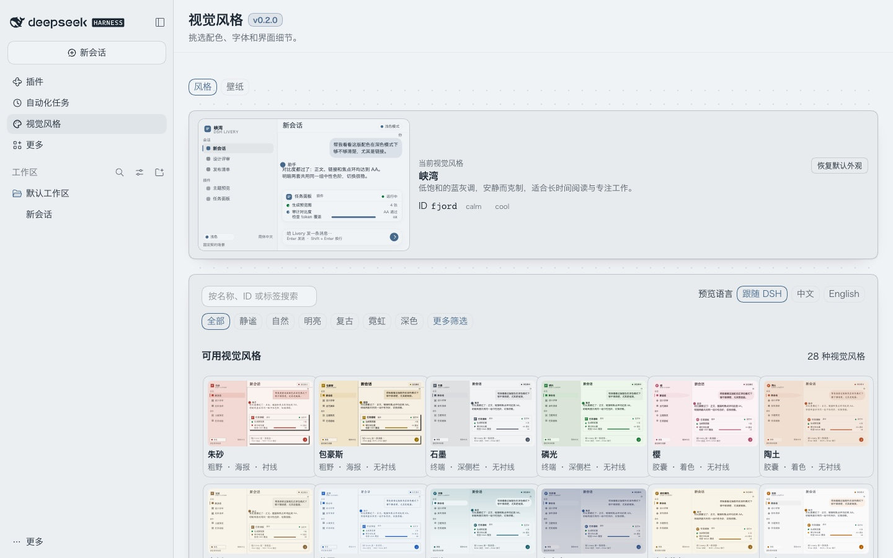
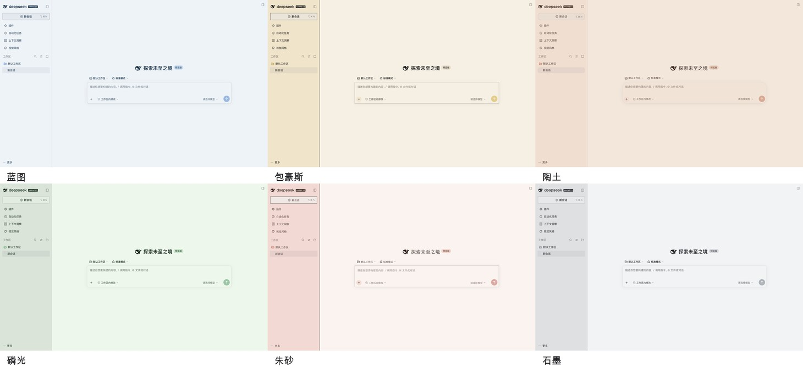
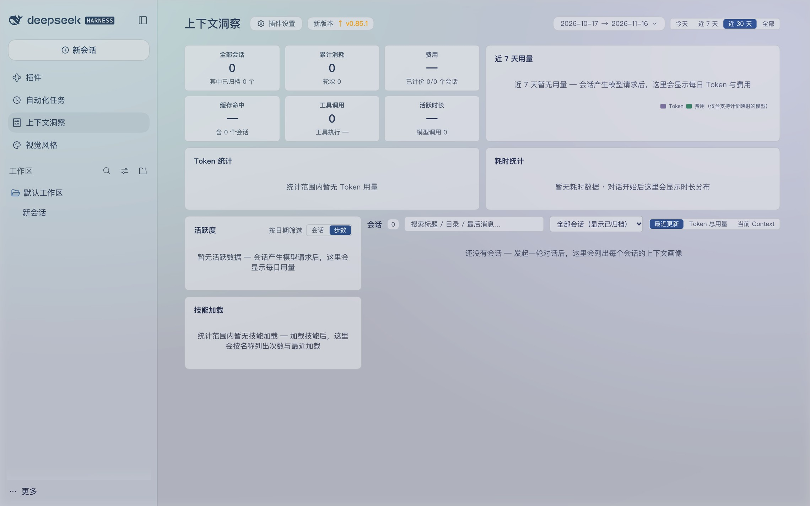

# DSH Livery (dsh-livery)

[](LICENSE)
[](https://www.npmjs.com/package/dsh-livery)
[](package.json)
[](#支持的-dsh-版本)

> **让 DSH 好看，也让 DSH 好用。**

DeepSeek Harness 的视觉层插件：**28 套精选风格**、带访问门禁的在线图片与虚化/磨砂效果的壁纸
工作室，以及视觉风格画廊。它以插件形式提供视觉层，**不接管宿主主题**。

> **发布状态：`0.2.3` 是当前版本（2026-11-26）。**
> 制品为 `dsh-livery@0.2.3`；13 个声明 scope 与 `0.2.2 → 0.2.3` Web 进程内更新转换均已绑定验收证据。
> **稳定认证：** DSH `0.2.1-rc.2` + Web Profile，DSH `0.2.1-rc.3` + macOS Desktop。
> **预览：** DSH `0.2.1-rc.4` Web、DSH `0.2.1-rc.5` Web/Desktop、DSH `0.2.2-rc.1`
> Web/Desktop、DSH `0.2.2-rc.2` Web/Desktop、DSH `0.2.2-rc.3` Web/Desktop、DSH `0.2.2-rc.5` Web/Desktop。
> `0.2.3` 只接受 exact-certified 宿主：未知构建整体 fail closed；Windows Desktop、Edge
> 和其他 DSH 构建不在支持范围内。

[English](README.md) · 中文



截图为中文界面；英文 README 使用英文界面。Livery 跟随 DSH 宿主语言。这里的视觉风格页在 `0.2.2` 中未改变；新的壁纸工作室与插件详情面见设计文档和 CHANGELOG。

## 0.2.3 更新

`0.2.3` 是同一组 8 个 exact-certified 宿主 adapter 上的客户端/Host 功能版本；不新增宿主 adapter，也不新增宿主能力。

- **两个免密钥直连图源。** 克利夫兰艺术博物馆与大都会艺术博物馆和 Wikimedia Commons 并列；其图片 CDN 通过插件自有 `` 展示，不假设 CORS、blob 缓存或 body 背景 URL。
- **Host 提供的 provider manifest。** `/livery/api/providers` 是审核后的注册表，客户端没有按 provider 写死的抓取实现。
- **仅搜索的直连源。** 选择 Cleveland/Met 会自动加载默认批次；Random 不渲染，不可用操作直接省略而不是灰置，结果数与归属合并为一行状态。
- **对比度与界面加固。** 宿主组件 token 对按 stock 基线审计，侧栏选中态保留可见 accent 与栏色阶，Online 卡片只保留一行操作和一行状态。
- **真实的 `0.2.2 → 0.2.3` Web 更新转换。** 保持既有 client gzip 上限与 stale-boot 修复路径。

## 0.2.2 更新（上一版）

`0.2.2` 是同一组 8 个 exact-certified 宿主 adapter 上的只改客户端的功能版本；不新增宿主 adapter，也不新增宿主能力。

- **精选壁纸 + Classic 兜底。** 主网格固定展示 8 张精选内置壁纸（`paper`、`ink`、`aurora`、
  `cyber`、`dusk`、`minimal`、`mono`、`sand`）；其余 16 张以 **Classic** 折叠组保留，ID 与
  CSS 逐字节不变。选中旧 ID 时会显示置顶的“当前（Classic）”色板，不丢失、不重映射任何 ID。
- **跟随风格（Follow style）。** 新增 `kind:'style'` 背景，由当前 Livery 的 catalog token
  按明/暗模式生成；不可调整焦点；catalog token 不可用时会禁用并给出可见原因。预设 schema v2
  可携带 style 目标与归属链接；v1 预设仍可导入。
- **一个通过访问门禁的在线图源。** 0.2.2 只提供 **Wikimedia Commons**（Openverse 通过门禁但因其匿名限额不可用而从提供列表移除）：
  它免密钥、已验证 CORS，并返回真实许可/归属元数据。NASA、大都会博物馆和芝加哥艺术
  博物馆未列入（权利或图片 CDN 验证受阻）；Picsum 已移除，因为 Unsplash 许可不允许这种
  用途。已有的 Picsum 远程选择仍从缓存渲染，新结果不再携带 Picsum 许可。
- **可预期的网络行为。** 打开壁纸页默认进入 Online，并自动随机请求一批；之后切换页签
  不会重新请求，也没有轮询或预取。Auto 在 12 秒总时限内尝试已提供且通过门禁的来源，并标明
  实际服务来源；固定来源不会静默切换。空结果与失败状态都有明确显示，并提供重试和回到
  内置/无壁纸的入口。
- **安全的归属信息。** 创作者、许可和来源链接随选中的远程图片一起保存，按 HTTPS 校验，并以
  `rel="noreferrer noopener"` 打开。最近使用只是展示镜像，不是第二份数据源。
- **插件详情页。** Livery 消费 `plugins.detail.actions`、`plugins.detail.badge` 和
  `plugins.detail.section`，展示可观测事实（构建、启动握手状态、宿主/adapter、当前风格与
  壁纸）和真实的更新边界说明；不添加更新按钮，也不复制宿主的安装控件。
- **Web 热更新边界。** 真实的 `0.2.1 → 0.2.2` Web client 更新可在进程内修复：接受精确
  allowlist 的 stale boot payload，重新拉取 catalog 并恢复已保存配置，要求 catalog profile
  严格相等，且不从 stale 帧采纳 CSS。Desktop 仍需 renderer 重载或重启应用；不声称 Desktop
  热更新。

## 功能亮点

- **六轴 28 套风格。** 色彩（OKLab seeds → 完整明暗 token）、字体（13 套本地字体栈，含 6 套中文字体、9 种
  排版配置）、模块形状、层级/材质、边框/焦点和组件 chrome。包含 14 套原创、12 套宽松
  许可配色和 2 套原创中式设计。
- **实时预览，而不是 Hero + 长滚动。** 当前风格在真实 DSH 表面旁展示说明；28 套风格放在
  一个连续的 6/4/3/2 列网格里，分类 chip 是唯一分类导航。
- **每张卡片都有风格 DNA。** 卡片直接标出表面配方、组件 chrome 和 UI 字体族，应用前
  就能分辨形状和组件差异。
- **GUI 优先的 palette。** 蓝图、包豪斯、陶土和磷光不是简单换色：工程青、明黄/钴蓝
  展示体、赤陶胶囊和绿色 CRT 终端表面。
- **组件 chrome。** `layout.chrome` 可从 seeds 推导并着色/描边/压暗/块状填充侧栏、
  composer、气泡、active 行和 selector；随包提供 6 个配方，28 套风格各选一个。
- **壁纸工作室。** 通过访问门禁的 Wikimedia Commons（带逐图归属）、24 张 CSS 壁纸总量
  （8 张精选 + 16 张 Classic）、Recent、跟随风格背景和本地/链接上传（IndexedDB）。
  模糊 0–24 px、变暗 0–70 %、磨砂 0–100 %、全局氛围。两层壁纸均为 viewport-relative `cover`，
  只裁切、不拉伸变形。打开页面默认进入 Online，并自动随机请求一批；之后切换来源页签不重新请求。
- **预设和焦点位置。** 导出/导入 风格 + 壁纸 + 效果 + 九宫格焦点；远程/上传壁纸支持指针和
  键盘焦点定位。schema v2 增加跟随风格目标与归属链接，v1 预设仍可导入。预设不包含上传
  blob、CSS、token 或本地路径。
- **macOS 侧栏清晰且独立。** 侧栏 fill 比主栏多 frost 20%（上限 94%），文字在浅色壁纸上可读，同时保留壁纸透视；最终 tint/wash 仍由宿主合成，探针测真实 DOM 表面。
- **插件详情页。** 插件管理器的 Livery 详情页展示可观测事实（客户端构建、启动握手状态、
  宿主/adapter、当前风格与壁纸）和真实的更新边界说明。Web client 更新可在进程内修复；
  Desktop 需要 renderer 重载或重启应用。不添加更新按钮或假控件。
- **可验证的信任边界。** 精确宿主 allowlist、冻结契约、纯 token CSS、loader ABI、
  对比度/CSS 审计和提交的验收 evidence。未知宿主安装时拒绝，运行时 fail closed 回 stock。

## 风格



28 套风格中的六套：**蓝图、包豪斯、陶土、磷光、朱砂、石墨**。每个画面都是应用该风格
后的真实 DSH 界面；画廊使用同一套预览。

## 壁纸

壁纸工作室与实时 16:9 预览。打开壁纸页默认进入 Online，并自动随机加载一批；内置图源仍可一键切换。选择 Cleveland 或 Met 会立即加载其默认批次（两者仅支持搜索，Random 禁用）。Auto 会标明实际服务来源。模糊、变暗、磨砂和全局氛围作用于
整个界面；焦点位置只对远程和上传壁纸可用，内置和跟随风格背景没有焦点控件。壁纸选择保存在
本地。

## 所有 DSH 插件页面



这是应用同一套风格和壁纸后的上下文洞察页。轨迹、上下文、编队等宿主插件页共享 livery
token 层：卡片、表格和浮层沿用同一套 surface 层级，第三方图表调色变量映射到当前风格
token；不写任何逐插件选择器或宿主 hashed class。

## 支持的 DSH 版本

`engines.dsh` 是经过 review 的 0.2 **可安装范围**；运行时只接受 exact-certified 宿主：

```text
>=0.2.1-rc.2 <0.3.0
```

只有正式矩阵中的构建才有运行时 adapter；范围内但未认证的构建可以安装，但会在 adapter 选择前 fail closed，不做版本号 fallback。

| 宿主版本 | 入口 | 运行时 | 状态 |
|---|---|---|---|
| DSH `0.2.1-rc.2` | Web Profile + Chrome `156.0.8078.48` | Node `22.23.1` | **稳定认证**（npm `latest`） |
| DSH `0.2.1-rc.3` | macOS Desktop app | Electron `44.7.0` / Node `24.21.0` / Chromium `152.0.7977.130` | **稳定认证**渲染器表面 |
| DSH `0.2.1-rc.4` | Web Profile + Chrome `156.0.8078.48` | Node `22.23.1` | **next 预览** |
| DSH `0.2.1-rc.5` | Web + macOS Desktop | Node `22.23.1` / `24.21.0` | **预览** |
| DSH `0.2.2-rc.1` | Web + macOS Desktop | Node `22.23.1` / `24.21.0` | **预览** |
| DSH `0.2.2-rc.2` | Web + macOS Desktop | Node `22.23.1` / `24.21.0` | **预览**（npm `next`） |
| DSH `0.2.2-rc.3` | Web + macOS Desktop | Chrome `156.0.8078.48` / Electron `44.7.0` / Node `24.21.0` / Chromium `152.0.7977.130` | **预览**（npm `next`） |
| DSH `0.2.2-rc.5` | Web + macOS Desktop | Chrome `156.0.8078.48` / Electron `44.7.0` / Node `22.23.1` / `24.21.0` / Chromium `152.0.7977.130` | **预览**（npm `latest`，GitHub prerelease） |

预览声明不是稳定性承诺：它仍要求矩阵中列出的精确 adapter，0.3+ 或 API 不一致的
构建仍会 fail closed。稳定支持要求官方 GitHub 非 prerelease 发布和 npm `latest` 上匹配的签名包；npm `next` 和 GitHub
prerelease 属于预览声明，不承诺渠道稳定性。macOS 原生窗口 chrome、红绿灯、vibrancy、
Dock/rightbar 和系统级 DPI 由宿主负责，不在插件认证范围内。完整策略见
[docs/design/multi-version.md](docs/design/multi-version.md)。

## 安装

npm 最新发布版：[`dsh-livery@0.2.2`](https://www.npmjs.com/package/dsh-livery)。

### Web Profile

```bash
dsh plugin --profile web add dsh-livery@0.2.2
dsh web
```

### Desktop app

```bash
dsh plugin --profile desktop add dsh-livery@0.2.2
```

包变化后重启 App。也可以在 **设置 → 插件** 中按包名安装。

如果新版本被 registry age window 拒绝：安装精确 release tarball，并先核对公布的
sha256。不要安装未校验的 tarball。

## 验收

`0.2.2` 制品已在全部 13 个 Web/Desktop scope 上完成隔离全量验收：
Web `0.2.1-rc.2`、`0.2.1-rc.4`、`0.2.1-rc.5`、`0.2.2-rc.1`、`0.2.2-rc.2`、`0.2.2-rc.3`、`0.2.2-rc.5`
与 Desktop `0.2.1-rc.3`、`0.2.1-rc.5`、`0.2.2-rc.1`、`0.2.2-rc.2`、`0.2.2-rc.3`、`0.2.2-rc.5`，
每个 scope 均为 **0 失败**。同时通过运行中的宿主插件管理器完成真实的 `0.2.1 → 0.2.2`
Web 更新验收：无页面重载、观察到 stale startup frame、catalog 重新采用、manager outcome
为 `applied`。证据绑定在 `contracts/dsh/evidence/0.2.2/`。范围、精确计数、制品 sha256 和
已知限制见 [docs/verification.md](docs/verification.md)。

发布门禁包括 `tsc`、完整测试、token/对比度/CSS 审计、loader ABI、支持矩阵/release
门禁、显式预算（client gzip 72 KiB、per-livery/boot CSS 14 KiB、tarball 4 MiB）、provider
访问门禁记录、`release:prepare` 和 `prepublish-check`。发布 workflow 不重新构建已验收 tarball。

## 文档

- [文档索引](docs/README.md)
- 设计：[接口](docs/design/interfaces.md) · [样式系统](docs/design/style-system.md) · [壁纸工作台](docs/design/wallpaper-workbench.md) · [插件详情面](docs/design/plugin-detail-surface.md) · [兼容架构](docs/design/compatibility.md) · [多版本策略](docs/design/multi-version.md)
- [验收摘要](docs/verification.md)
- [CHANGELOG](CHANGELOG.md) · [SECURITY](SECURITY.md) · [NOTICE](NOTICE.md) · [SUPPORT](SUPPORT.md)

## 早期版本

- **0.2.2** — 壁纸工作室（8 精选 + 16 Classic、Follow style、Wikimedia Commons）、
  provider/许可加固、插件详情面、`MenuSurface`/jobs 表面不透明与 Web
  `0.2.1 → 0.2.2` 热更新修复。当前版本。
- **0.2.1** — `--dsw-specific-menu` 别名改为不透明，直接绘制侧栏 alpha 与 macOS 合成路径对齐；真正的 `MenuSurface` fill 与 jobs fill token 在 0.2.2 补齐。已发布。
- **0.2.0** — 视觉语言升级：13 套本地字体栈、按风格的标签层级、26/28 风格的 L5a Studio
  Decoration、更克制的风格页、v2 presentation axes 与协议加固。详见 [CHANGELOG](CHANGELOG.md)。

## 许可

MIT，见 [LICENSE](LICENSE)。配色来源见 [NOTICE.md](NOTICE.md)。预览缩略图和内置壁纸都由
插件自己的数据生成；可选的壁纸工作室只在你激活 Online 页签或主动操作时才加载在线图片
（见 [SECURITY.md](SECURITY.md)）。在线图片在运行时从 Wikimedia Commons
获取，不随包分发，并在界面中展示逐图归属信息。
